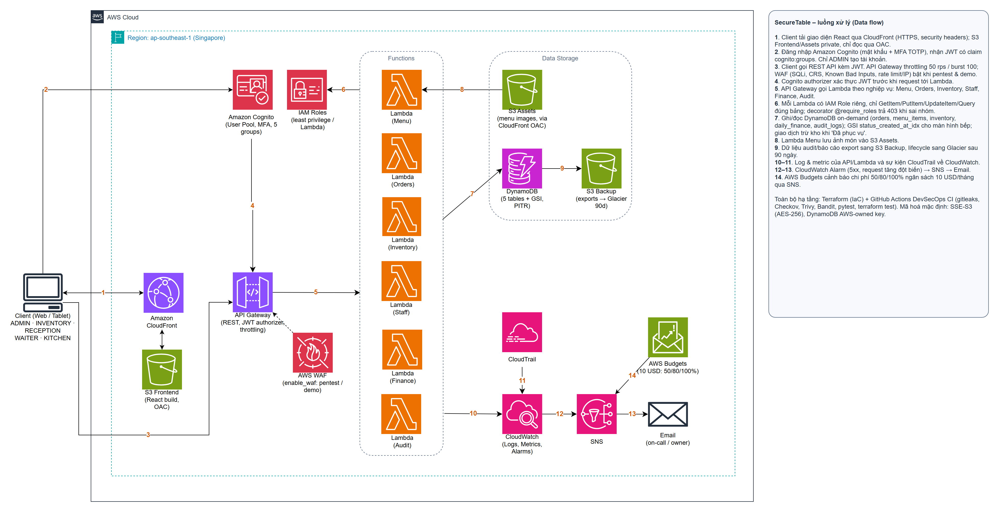

# SECURETABLE – A SECURE RESTAURANT MANAGEMENT SYSTEM ON AWS
### An AWS Serverless solution for ordering, inventory and finance in small restaurants

### 1. Executive Summary

SecureTable is a tablet-friendly web application that helps family eateries and small restaurants (5–20 staff) take orders, coordinate the kitchen, deduct inventory by recipe and record income and expenses. It is built entirely on AWS serverless services in the Singapore region, managed 100% with Terraform, and protected by a DevSecOps pipeline that runs security checks on every pull request.

The project focuses on **multi-layer security at low cost**: MFA for every account, admin-only account creation, two-layer authorization for 5 roles, WAF against SQLi/XSS and an audit log for every sensitive action. Estimated running cost is **about 1.5–2.1 USD/month**, well under the team's 10 USD/month cap.

### 2. Problem Statement

**What's the Problem?**

Surveys with family eateries and a cook working at an eatery revealed five recurring issues:
- Orders are taken verbally or on paper, so tables and dishes get mixed up at peak hours.
- Nobody knows the real stock level until the kitchen runs out after customers have ordered.
- Bills are calculated with a pocket calculator and there is no trace of who opened, edited or voided a bill, so revenue can leak.
- Income and expenses are unclear, so the owner does not know the monthly profit.
- Business data lives in shared files with no access control or protection.

**The Solution**

Staff place orders on a tablet and orders go straight to the kitchen screen. When the kitchen marks a dish as "served", inventory is deducted by recipe automatically. The cashier closes the bill and revenue is recorded in the daily ledger. Each person can only see and do what their role allows (ADMIN, INVENTORY, RECEPTION, WAITER, KITCHEN). Every sensitive action is written to an audit log.

**Benefits and Return on Investment**
- Fewer wrong or missed dishes because electronic orders go straight to the kitchen.
- Real-time stock with warnings before ingredients run out.
- Less fraud thanks to the audit log and role-based access.
- Cloud cost of about 2 USD/month and no servers to buy. The restaurant only needs the tablets it already has.

### 3. Solution Architecture

The architecture has three layers:
- **Edge**: CloudFront serves the UI, API Gateway receives requests and WAF filters malicious traffic.
- **Processing**: Cognito authenticates users and 6 Lambda functions run the business logic.
- **Data**: DynamoDB and S3.

CloudWatch, CloudTrail, SNS and AWS Budgets handle monitoring and alerting.

**AWS Services Used**

| Service | Role |
| --- | --- |
| Amazon CloudFront | Serves the React UI and menu images over HTTPS with security headers |
| Amazon S3 | 3 private buckets: `frontend`, `assets`, `backup` (Glacier after 90 days) |
| Amazon Cognito | User Pool, TOTP MFA, 5 role groups, admin-only account creation |
| Amazon API Gateway | REST API, Cognito authorizer, throttling 50 rps / burst 100 |
| AWS WAF | Managed Rules (Common, SQLi, Known Bad Inputs) + per-IP rate limit, enabled for pentest/demo |
| AWS Lambda | 6 Python functions: Menu, Orders, Inventory, Staff, Finance, Audit |
| Amazon DynamoDB | 5 on-demand tables + GSI `status_created_at_idx`, PITR |
| AWS IAM | A dedicated least-privilege role per Lambda |
| Amazon CloudWatch, AWS CloudTrail | Logs, metrics, dashboard, alarms; API auditing |
| Amazon SNS, AWS Budgets | Email alerts; 10 USD/month budget |

**Component Design**
- **UI**: the static React build is stored in S3 and can only be read through CloudFront (Origin Access Control).
- **Identity**: Cognito issues JWTs with the `cognito:groups` claim. The Cognito authorizer only checks that the token is valid. The `@require_roles` decorator in Lambda checks the role and returns 403 for the wrong role.
- **Data**: the tables `orders`, `menu_items`, `inventory`, `daily_finance` and `audit_logs` all use `restaurant_id` as the partition key. The kitchen screen queries a GSI by status and time. "Served" runs a `TransactWriteItems` transaction that updates the order and deducts stock in one step.
- **Monitoring**: alarms on 5xx errors and request spikes go to SNS. AWS Budgets alerts at 50%, 80% and 100% of the budget.

### 4. Technical Implementation

**Implementation Phases**
1. **Survey and topic selection** (weeks 3–4): surveyed businesses and families, mapped findings to the graduation requirements.
2. **Design and first infrastructure** (weeks 5–6): studied AWS security and Terraform, built a trial 3-tier architecture.
3. **Move to serverless** (weeks 7–8): built 7 Terraform modules, ran a security review and added the DevSecOps pipeline to CI.
4. **Integration, testing, demo** (weeks 9–12): wrote the Lambdas and API routes, put the frontend on CloudFront, added monitoring, ran the WAF pentest and a recovery drill.

**Technical Requirements**
- Terraform ≥ 1.9, AWS Provider 5.x; AWS CLI v2; Python 3.12 for Lambda; Node.js 20 for the frontend (React + Vite).
- GitHub Actions: gitleaks, Checkov, Trivy, Bandit, Flake8, pytest, `terraform fmt/validate/test`.
- PowerShell scripts `deploy_and_test.ps1` (deploy and verify) and `nuke_and_teardown.ps1` (tear everything down to 0 USD).

### 5. Timeline & Milestones

| Milestone | Dates | Outcome |
| --- | --- | --- |
| Topic selection | 09/29 – 10/07/2026 | Surveys, analysis, requirement → evidence matrix |
| Infrastructure v1 (3-tier) | 10/19 – 10/25/2026 | Terraform modules for VPC, EC2, RDS, Secrets |
| Move to serverless | 10/26 – 11/04/2026 | 7 serverless modules, architecture diagram v1.0.0 |
| Security review + CI | 11/05 – 11/06/2026 | MFA, admin-only sign-up, 10 IaC tests, blocking CI |
| Integration + demo | 11/24 – 11/27/2026 | Lambda, API routes, CloudFront, monitoring, pentest |
| Submission | 11/30/2026 | Bilingual report, summary .md, architecture .xml |

### 6. Budget Estimation

Assumptions for one pilot restaurant: 15 accounts, about 200 orders per day and about 200,000 API requests per month. Unit prices come from the AWS Price List for the Singapore region, November 2026.

| Service | USD/month |
| --- | --- |
| API Gateway REST (0.2M requests × 4.25 USD) | 0.85 |
| Lambda (within the free tier) | 0.00 |
| DynamoDB on-demand + PITR | 0.25 |
| S3 (1.2 GB) | 0.04 |
| CloudFront (within the 1 TB free tier) | 0.00 |
| Cognito (15 MAU) | 0.00 |
| CloudWatch (0.5 GB logs, alarms, dashboard) | 0.36 |
| CloudTrail, SNS, Budgets | 0.00 |
| **Total with WAF off** | **≈ 1.50** |
| WAF on for 2 days (pentest + demo) | ≈ 0.60 |
| **Total in a pentest/demo month** | **≈ 2.10** |

Running WAF for the whole month would cost about 9.10 USD on its own (a 5 USD Web ACL plus 4 rules). That is why WAF is controlled by the `enable_waf` flag.

AWS Pricing Calculator estimate: *(team to add link)*.

### 7. Risk Assessment

**Risk Matrix**

| Risk | Impact | Probability |
| --- | --- | --- |
| Budget overrun (WAF left on, resources not cleaned up) | Medium | Medium |
| Leaked access key / secret | High | Low |
| Staff accessing owner data with the wrong role | High | Medium |
| SQLi/XSS attacks, login brute force | High | Low |
| Data loss from accidental deletion | High | Low |

**Mitigation Strategies**
- **Cost**: AWS Budgets at 50/80/100%, WAF behind a flag, and the nuke script run after every practice session.
- **Secrets**: gitleaks scans the full Git history in CI, no credentials in code, moving toward OIDC-based deployment.
- **Authorization**: the `@require_roles` decorator is unit-tested, and each Lambda has its own IAM role.
- **Web attacks**: WAF Managed Rules, throttling and per-IP rate limiting, Cognito MFA.
- **Data**: DynamoDB PITR, S3 versioning, and infrastructure that can be rebuilt with Terraform.

**Contingency Plan**: if an incident happens, run `nuke_and_teardown.ps1` and then `deploy_and_test.ps1` to rebuild the whole infrastructure. Restore data from PITR or from the exports in the `backup` bucket.

### 8. Expected Outcomes

- **Technical improvements**: a complete serverless architecture, 100% IaC, CI/CD with security testing, automated monitoring and alerting, all under 10 USD/month.
- **Long-term value**: a platform that can grow to multiple branches (multi-tenant by `restaurant_id`). It also serves as a reference for security-focused serverless projects on a small budget.
