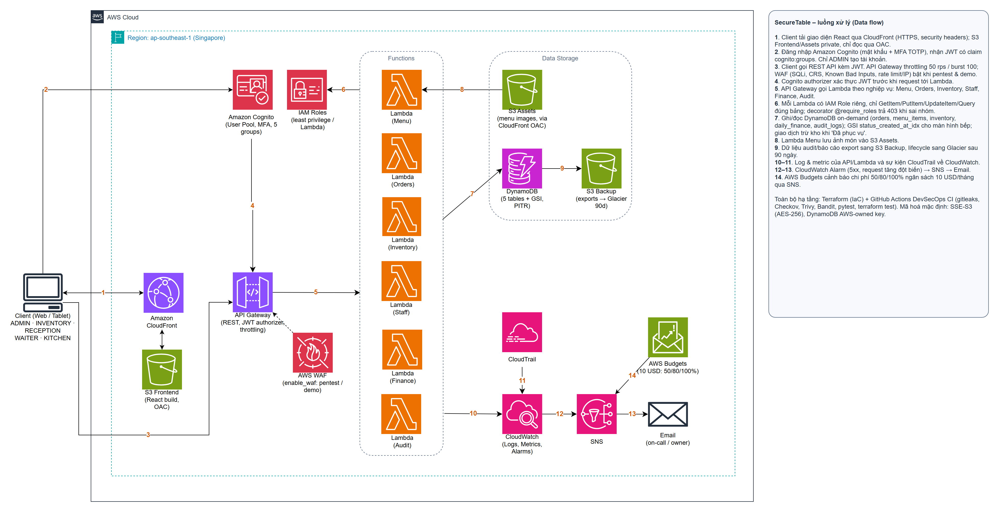

# SECURETABLE – HỆ THỐNG QUẢN LÝ NHÀ HÀNG AN TOÀN TRÊN AWS
### Giải pháp AWS Serverless cho gọi món, quản lý kho và thu chi của quán ăn nhỏ

### 1. Tóm tắt điều hành

SecureTable là ứng dụng web chạy trên tablet giúp quán ăn gia đình và nhà hàng nhỏ (5–20 nhân viên) gọi món, điều phối bếp, trừ kho theo công thức và ghi nhận thu chi. Hệ thống được xây hoàn toàn bằng dịch vụ serverless của AWS tại region Singapore, quản lý 100% bằng Terraform, có pipeline DevSecOps kiểm tra bảo mật trên mọi pull request.

Điểm nhấn của dự án là **bảo mật nhiều lớp với chi phí thấp**: MFA cho mọi tài khoản, chỉ chủ quán được tạo tài khoản, phân quyền hai tầng cho 5 vai trò, WAF chống SQLi/XSS, audit log cho mọi thao tác nhạy cảm. Chi phí vận hành ước tính **khoảng 1,5–2,1 USD/tháng**, dưới trần ngân sách 10 USD/tháng của nhóm.

### 2. Tuyên bố vấn đề

**Vấn đề hiện tại**

Khảo sát các quán ăn gia đình và một đầu bếp đang làm tại quán cho thấy năm vấn đề lặp lại:
- Gọi món bằng lời nói và sổ tay, giờ cao điểm dễ nhầm bàn, sót món.
- Không biết tồn kho thực tế, đến khi bếp báo hết nguyên liệu thì khách đã gọi món.
- Tính tiền bằng máy tính bỏ túi, không có dấu vết ai mở, sửa, huỷ hoá đơn, dễ thất thoát doanh thu.
- Thu chi không rõ ràng, cuối tháng không biết lãi lỗ.
- Dữ liệu kinh doanh nằm trong file dùng chung, không phân quyền, không có bảo vệ.

**Giải pháp**

Nhân viên dùng tablet để gọi món. Đơn hàng đi thẳng tới màn hình bếp. Khi bếp bấm "Đã phục vụ", hệ thống tự trừ kho theo công thức món. Thu ngân đóng hoá đơn và doanh thu được ghi vào sổ thu chi theo ngày. Mỗi người chỉ thấy và làm được đúng phần việc của vai trò mình (ADMIN, INVENTORY, RECEPTION, WAITER, KITCHEN). Mọi thao tác nhạy cảm đều được ghi audit log.

**Lợi ích và hoàn vốn đầu tư (ROI)**
- Giảm nhầm món và sót món nhờ đơn điện tử đi thẳng tới bếp.
- Biết tồn kho theo thời gian thực, cảnh báo trước khi hết nguyên liệu.
- Hạn chế gian lận nhờ audit log và phân quyền.
- Chi phí đám mây khoảng 2 USD/tháng, không cần mua máy chủ. Quán chỉ cần tablet sẵn có.

### 3. Kiến trúc giải pháp

Kiến trúc gồm ba lớp:
- **Lớp biên**: CloudFront phục vụ giao diện, API Gateway nhận request, WAF lọc request độc hại.
- **Lớp xử lý**: Cognito xác thực người dùng, 6 hàm Lambda xử lý nghiệp vụ.
- **Lớp dữ liệu**: DynamoDB và S3.

CloudWatch, CloudTrail, SNS và AWS Budgets lo phần giám sát và cảnh báo.

**Dịch vụ AWS sử dụng**

| Dịch vụ | Vai trò |
| --- | --- |
| Amazon CloudFront | Phân phối giao diện React và ảnh món qua HTTPS, thêm security headers |
| Amazon S3 | 3 bucket private: `frontend`, `assets`, `backup` (Glacier sau 90 ngày) |
| Amazon Cognito | User Pool, MFA TOTP, 5 nhóm vai trò, chỉ admin tạo tài khoản |
| Amazon API Gateway | REST API, Cognito authorizer, throttling 50 rps / burst 100 |
| AWS WAF | Managed Rules (Common, SQLi, Known Bad Inputs) + rate limit theo IP, bật khi pentest/demo |
| AWS Lambda | 6 hàm Python: Menu, Orders, Inventory, Staff, Finance, Audit |
| Amazon DynamoDB | 5 bảng on-demand + GSI `status_created_at_idx`, PITR |
| AWS IAM | Role riêng cho từng Lambda theo nguyên tắc quyền tối thiểu |
| Amazon CloudWatch, AWS CloudTrail | Log, metric, dashboard, alarm; kiểm toán API |
| Amazon SNS, AWS Budgets | Gửi cảnh báo email; ngân sách 10 USD/tháng |

**Thiết kế thành phần**
- **Giao diện**: React build tĩnh lưu ở S3, chỉ đọc được qua CloudFront (Origin Access Control).
- **Định danh**: Cognito cấp JWT có claim `cognito:groups`. Cognito authorizer chỉ kiểm tra token hợp lệ. Decorator `@require_roles` trong Lambda kiểm tra vai trò (sai vai trò trả 403).
- **Dữ liệu**: các bảng `orders`, `menu_items`, `inventory`, `daily_finance`, `audit_logs` dùng chung khóa phân vùng `restaurant_id`. Màn hình bếp truy vấn GSI theo trạng thái và thời gian. Thao tác "Đã phục vụ" dùng giao dịch `TransactWriteItems` để vừa cập nhật đơn vừa trừ kho.
- **Giám sát**: alarm lỗi 5xx và request tăng đột biến gửi qua SNS. AWS Budgets cảnh báo ở mốc 50%, 80% và 100% ngân sách.

### 4. Triển khai kỹ thuật

**Các giai đoạn triển khai**
1. **Khảo sát và chọn đề tài** (tuần 3–4): khảo sát doanh nghiệp và gia đình, đối chiếu với yêu cầu tốt nghiệp.
2. **Thiết kế và bản hạ tầng đầu tiên** (tuần 5–6): học bảo mật AWS và Terraform, dựng thử kiến trúc 3-tier.
3. **Chuyển sang serverless** (tuần 7–8): dựng 7 module Terraform, rà soát bảo mật, đưa pipeline DevSecOps vào CI.
4. **Đấu nối, kiểm thử, demo** (tuần 9–12): viết Lambda và các route API, đưa frontend lên CloudFront, giám sát, pentest WAF, diễn tập khôi phục.

**Yêu cầu kỹ thuật**
- Terraform ≥ 1.9, AWS Provider 5.x; AWS CLI v2; Python 3.12 cho Lambda; Node.js 20 cho frontend (React + Vite).
- GitHub Actions: gitleaks, Checkov, Trivy, Bandit, Flake8, pytest, `terraform fmt/validate/test`.
- Script PowerShell `deploy_and_test.ps1` (triển khai và kiểm tra) và `nuke_and_teardown.ps1` (dọn sạch về 0 USD).

### 5. Lộ trình & mốc triển khai

| Mốc | Thời gian | Kết quả |
| --- | --- | --- |
| Chọn đề tài | 29/09 – 07/10/2026 | Khảo sát, phân tích, ma trận yêu cầu → minh chứng |
| Hạ tầng v1 (3-tier) | 19 – 25/10/2026 | Module Terraform VPC, EC2, RDS, Secrets |
| Chuyển serverless | 26/10 – 04/11/2026 | 7 module serverless, sơ đồ kiến trúc v1.0.0 |
| Rà soát bảo mật + CI | 05 – 06/11/2026 | MFA, chỉ admin tạo user, 10 test IaC, CI chặn |
| Đấu nối + demo | 24 – 27/11/2026 | Lambda, route API, CloudFront, giám sát, pentest |
| Nộp bài | 30/11/2026 | Báo cáo song ngữ, summary .md, architecture .xml |

### 6. Ước tính ngân sách

Giả định một nhà hàng chạy thử: 15 tài khoản, khoảng 200 đơn mỗi ngày, khoảng 200.000 request API mỗi tháng. Đơn giá lấy từ AWS Price List, region Singapore, tháng 11/2026.

| Dịch vụ | USD/tháng |
| --- | --- |
| API Gateway REST (0,2 triệu request × 4,25 USD) | 0,85 |
| Lambda (trong mức miễn phí) | 0,00 |
| DynamoDB on-demand + PITR | 0,25 |
| S3 (1,2 GB) | 0,04 |
| CloudFront (trong mức miễn phí 1 TB) | 0,00 |
| Cognito (15 MAU) | 0,00 |
| CloudWatch (0,5 GB log, alarm, dashboard) | 0,36 |
| CloudTrail, SNS, Budgets | 0,00 |
| **Tổng khi WAF tắt** | **≈ 1,50** |
| WAF bật 2 ngày (pentest + demo) | ≈ 0,60 |
| **Tổng tháng có pentest/demo** | **≈ 2,10** |

Nếu bật WAF suốt tháng, riêng WAF tốn khoảng 9,10 USD (5 USD Web ACL và 4 rule). Vì vậy WAF được điều khiển bằng cờ `enable_waf`.

Bảng dự toán AWS Pricing Calculator: *(nhóm bổ sung link)*.

### 7. Đánh giá rủi ro

**Ma trận rủi ro**

| Rủi ro | Ảnh hưởng | Xác suất |
| --- | --- | --- |
| Vượt ngân sách (bật WAF, quên dọn tài nguyên) | Trung bình | Trung bình |
| Lộ access key / secret | Cao | Thấp |
| Nhân viên sai vai trò truy cập dữ liệu chủ quán | Cao | Trung bình |
| Tấn công SQLi/XSS, brute-force đăng nhập | Cao | Thấp |
| Mất dữ liệu do xoá nhầm | Cao | Thấp |

**Chiến lược giảm thiểu**
- **Chi phí**: AWS Budgets ở mốc 50/80/100%, WAF bật theo cờ, script nuke chạy sau mỗi buổi thực hành.
- **Secret**: gitleaks quét toàn bộ lịch sử Git trong CI, không lưu credential trong code, hướng tới deploy bằng OIDC.
- **Phân quyền**: decorator `@require_roles` có unit test, IAM role riêng cho từng Lambda.
- **Tấn công web**: WAF Managed Rules, throttling và rate limit theo IP, Cognito MFA.
- **Dữ liệu**: DynamoDB PITR, S3 versioning, hạ tầng dựng lại được bằng Terraform.

**Kế hoạch dự phòng**: khi có sự cố, chạy `nuke_and_teardown.ps1` rồi `deploy_and_test.ps1` để dựng lại toàn bộ hạ tầng. Dữ liệu được khôi phục từ PITR hoặc từ bản export trong bucket `backup`.

### 8. Kết quả kỳ vọng

- **Cải tiến kỹ thuật**: một kiến trúc serverless hoàn chỉnh, 100% IaC, CI/CD có kiểm thử bảo mật, giám sát và cảnh báo tự động, chi phí dưới 10 USD/tháng.
- **Giá trị dài hạn**: nền tảng mở rộng được cho nhiều chi nhánh (multi-tenant theo `restaurant_id`). Đây cũng là mẫu tham khảo cho các dự án serverless có yêu cầu bảo mật cao với ngân sách nhỏ.
