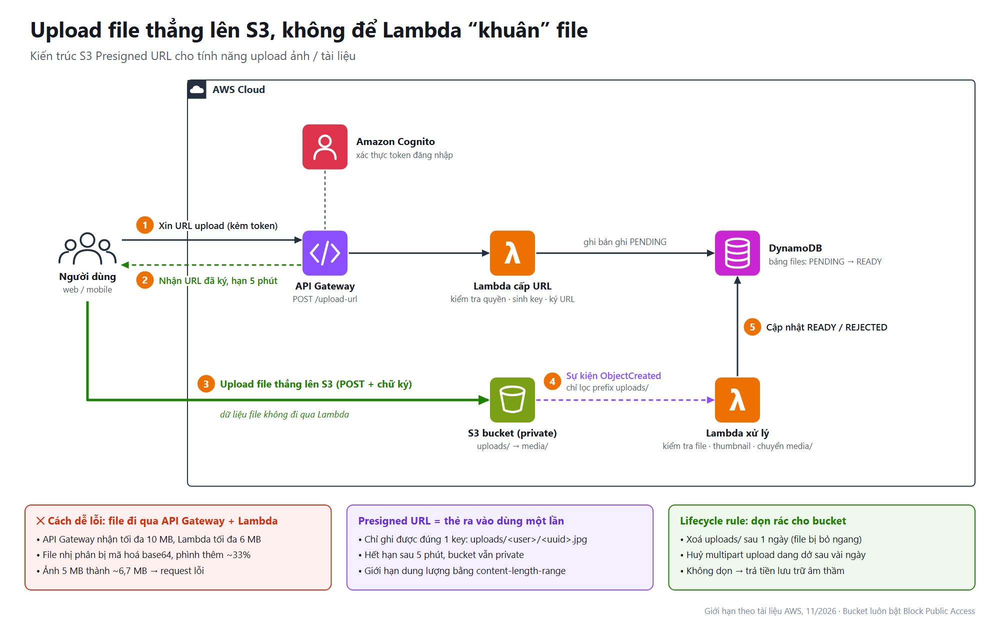

# A 5 MB PHOTO THAT WON'T UPLOAD? STOP MAKING LAMBDA CARRY YOUR FILES

> Posted in the AWS Study Group community: [original post](https://www.facebook.com/groups/660548818043427/?multi_permalinks=2341282956636663) · Author: Nguyen Tien Thanh



When you build an image upload feature for a serverless app, the first idea is usually: the client sends the file to API Gateway, Lambda receives it and writes it to S3. It works with a 1 MB image. Then a user picks a 5 MB photo from their phone and the request starts failing.

This post summarizes the approach AWS recommends for this problem: **S3 presigned URLs**. You will learn what they are, what the architecture looks like, whether they are cheaper, and where people usually get them wrong.

### 1. The problem: the backend should not be the porter

- API Gateway (REST API) accepts a payload of at most 10 MB.
- A synchronously invoked Lambda accepts a request of at most 6 MB.
- Binary files going through API Gateway to Lambda are usually base64-encoded and grow by about 33%. A 5 MB image becomes about 6.7 MB, which exceeds Lambda's 6 MB limit.
- Every byte of the file passes through the backend. That costs memory and run time, and the backend has to scale with upload bandwidth instead of with the number of users.

### 2. What is a presigned URL?

A presigned URL is a link to S3 that has been signed in advance with the backend's permissions. Whoever holds the link can do exactly one signed action (for example, upload to the key `uploads/u123/abc.jpg`), and only for a short time (for example, 5 minutes). After it expires, the link is useless.

Think of it this way: instead of the receptionist (backend) taking the parcel and carrying it into the warehouse, the receptionist gives the courier (browser) a pass that opens exactly one locker and expires in 5 minutes. The courier carries the parcel into the warehouse (S3) directly.

The bucket stays private, and the client does not need any AWS access key.

### 3. Architecture (see the illustration at the top)

1. The client calls an "ask for an upload URL" API with its login token. API Gateway validates the token with Amazon Cognito and calls the URL-issuing Lambda. That Lambda checks permissions, generates the key itself (it never uses the file name sent by the user), restricts file type and size, signs a URL valid for 5 minutes, and writes a PENDING record to DynamoDB.
2. The client receives the signed URL.
3. The client uploads the file straight to S3 with that URL. The file never goes through Lambda.
4. S3 emits an `ObjectCreated` event (filtered on the `uploads/` prefix). A processing Lambda checks the real content of the file (it reads the first bytes instead of trusting the client's Content-Type), creates a thumbnail and moves the file to `media/`.
5. The processing Lambda updates DynamoDB to READY (or REJECTED if the file is invalid). The client polls the status to display it.

Signing the URL in Python (boto3). I use a presigned **POST** instead of PUT because POST lets you cap the size with a `content-length-range` condition (10 MB here):

```python
s3.generate_presigned_post(
    Bucket=BUCKET,
    Key=f"uploads/{user_id}/{uuid4()}.jpg",
    Fields={"Content-Type": "image/jpeg"},
    Conditions=[
        {"Content-Type": "image/jpeg"},
        ["content-length-range", 1, 10 * 1024 * 1024],
    ],
    ExpiresIn=300,
)
```

### 4. Cost: is it cheaper?

Yes, but honestly money is not the main benefit.

Example with 100,000 images per month, 4 MB each, in the Singapore region (November 2026 prices):
- **File passes through Lambda**: Lambda needs a lot of memory to hold the file (say 1,024 MB) and runs about 1 second per call. That is about 100,000 GB-seconds ≈ 1.7 USD.
- **Presigned URL**: Lambda only signs the URL (128 MB, about 50 ms). That is about 625 GB-seconds ≈ 0.01 USD.
- **API Gateway and S3 requests**: API Gateway (4.25 USD per million requests) and S3 PUT requests (0.005 USD per 1,000) cost about the same either way.

The difference is only a few dollars a month. The real benefits are elsewhere:
- **No more 6 MB / 10 MB limit**: a single upload to S3 can be up to 5 GB, and multipart upload handles larger files.
- **The backend does not scale with bandwidth.**
- **Fewer places that can time out.**

The real money leaks are where few people look:
- **Orphan files**: a user asks for a URL, uploads, then abandons the form. The file sits in the bucket forever at 0.025 USD/GB-month.
- **Unfinished multipart uploads**: uploaded parts are still billed for storage but do not show up when you list objects.

→ Add lifecycle rules: delete objects under `uploads/` after 1 day (valid files were already moved to `media/` in step 4) and abort incomplete multipart uploads after a few days.

### 5. Lessons learned: common mistakes

- **Never use the user's file name as the key.** It is easy to overwrite someone else's file. The backend generates the key from the user ID plus a UUID.
- **A presigned PUT cannot enforce a size range.** If you need one, use a presigned POST with `content-length-range`.
- **Do not trust the client's Content-Type.** Re-check the real content after upload (step 4).
- **URLs signed with temporary credentials expire earlier than you think.** A URL signed by Lambda uses the role's temporary credentials and stops working when they expire, even if `ExpiresIn` is longer. Keep the lifetime short (5–15 minutes).
- **Browser uploads need CORS on the bucket.** Allow only your domain and only the methods you use.
- **Beware of infinite loops.** If the processing Lambda writes into the same prefix that triggers it, it will keep invoking itself. Filter events on `uploads/` and write results to another prefix.
- **Always keep Block Public Access on.** Presigned URLs do not need a public bucket.

### 6. How to verify

- **Valid upload**: a file of the right type and under the limit succeeds, and DynamoDB moves to READY.
- **Too large**: S3 rejects the upload with `EntityTooLarge`.
- **Expired URL**: S3 rejects it with `AccessDenied` (policy expired).
- **Tampered key**: changing the key in the form to another user's folder is rejected because it no longer matches the signature.
- **Disguised file**: an `.exe` renamed to `.jpg` is caught in step 4 and marked REJECTED.

### Summary in 3 lines

- The backend grants permission and S3 receives the file; file data never goes through Lambda.
- A presigned URL is permission to do exactly one thing, on exactly one key, for a few minutes.
- Add lifecycle rules to clean up orphan files and unfinished multipart uploads, or your S3 bill will quietly grow.

### References

- Presigned URLs and expiration: <https://docs.aws.amazon.com/AmazonS3/latest/userguide/using-presigned-url.html>
- Uploading objects with presigned URLs: <https://docs.aws.amazon.com/AmazonS3/latest/userguide/PresignedUrlUploadObject.html>
- Lambda payload quotas: <https://docs.aws.amazon.com/lambda/latest/dg/gettingstarted-limits.html>
- Lifecycle rule to abort incomplete multipart uploads: <https://docs.aws.amazon.com/AmazonS3/latest/userguide/mpu-abort-incomplete-mpu-lifecycle-config.html>

*Note: reference prices for Singapore (ap-southeast-1) come from the AWS Price List, November 2026. This is a proposed architecture; the cost figures are estimates, not measurements from a production system.*
