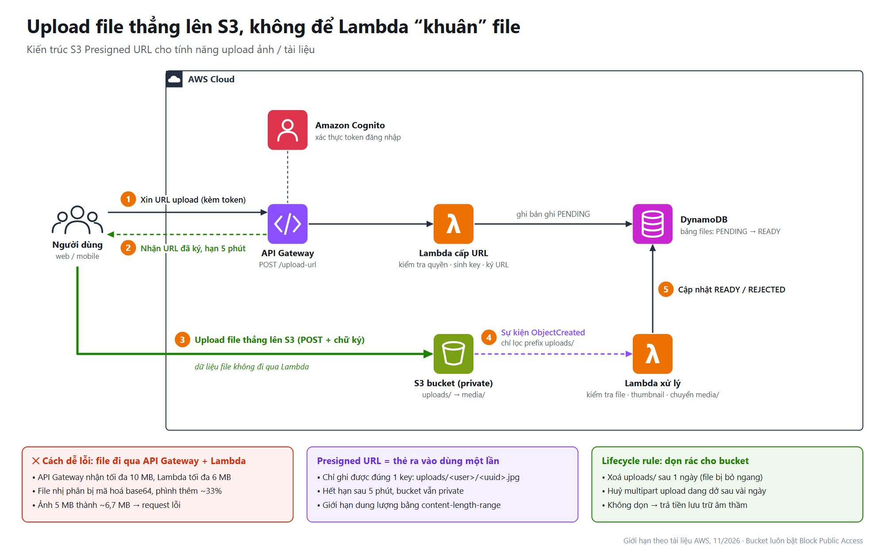

# ẢNH 5 MB MÀ UPLOAD KHÔNG ĐƯỢC? ĐỪNG BẮT LAMBDA ĐI "KHUÂN" FILE

> Bài viết đã đăng trên nhóm AWS Study Group: [xem bài gốc](https://www.facebook.com/groups/660548818043427/?multi_permalinks=2341282956636663) · Tác giả: Nguyễn Tiến Thành



Khi làm tính năng upload ảnh cho ứng dụng serverless, cách nghĩ đầu tiên thường là: client gửi file lên API Gateway, Lambda nhận rồi ghi vào S3. Thử với ảnh 1 MB thì chạy ngon. Nhưng khi người dùng chọn ảnh chụp từ điện thoại khoảng 5 MB, request bắt đầu lỗi.

Bài này mình tổng hợp cách làm được AWS khuyến nghị cho bài toán này: S3 Presigned URL. Đọc xong, bạn sẽ biết nó là gì, kiến trúc trông ra sao, có rẻ hơn không và những chỗ dễ làm sai.


### 1. Vấn đề: backend không nên là người khuân vác


- API Gateway (REST API) chỉ nhận payload tối đa 10 MB.
- Lambda gọi đồng bộ chỉ nhận request tối đa 6 MB.
- File nhị phân đi qua API Gateway tới Lambda thường bị mã hoá base64 và phình thêm khoảng 33%. Ảnh 5 MB thành khoảng 6,7 MB, vượt giới hạn 6 MB của Lambda.
- Mọi byte của file đều đi qua backend: tốn bộ nhớ, tốn thời gian chạy, và backend phải scale theo băng thông upload thay vì theo số người dùng.


### 2. Presigned URL là gì?


Presigned URL là một đường link tới S3 đã được "ký sẵn" bằng quyền của backend. Ai cầm link thì làm được đúng một việc đã ký (ví dụ: upload vào đúng key uploads/u123/abc.jpg) và chỉ trong một khoảng thời gian ngắn (ví dụ 5 phút). Hết hạn, link vô dụng.

Hình dung thế này: thay vì lễ tân (backend) tự nhận hàng rồi mang vào kho, lễ tân đưa cho shipper (trình duyệt) một thẻ ra vào chỉ mở được đúng một ngăn tủ và hết hạn sau 5 phút. Shipper tự mang hàng vào kho (S3).

Bucket vẫn private. Client không cần access key AWS nào.


### 3. Kiến trúc (xem ảnh minh hoạ ở đầu bài)


① Client gọi API "xin URL upload", kèm token đăng nhập. API Gateway kiểm tra token bằng Amazon Cognito rồi gọi Lambda cấp URL. Lambda này kiểm tra quyền, tự sinh key (không dùng tên file người dùng gửi lên), giới hạn loại file và dung lượng, ký URL có hạn 5 phút, rồi ghi một bản ghi PENDING vào DynamoDB.
② Client nhận URL đã ký.
③ Client upload file thẳng lên S3 bằng URL đó. File không đi qua Lambda.
④ S3 phát sự kiện ObjectCreated (chỉ lọc prefix uploads/). Lambda xử lý kiểm tra nội dung thật của file (đọc vài byte đầu, không tin Content-Type client gửi), tạo thumbnail, rồi chuyển file sang media/.
⑤ Lambda xử lý cập nhật DynamoDB sang READY (hoặc REJECTED nếu file không hợp lệ). Client hỏi trạng thái để hiển thị.

Đoạn ký URL bằng Python (boto3). Mình dùng presigned POST thay vì PUT, vì POST cho phép giới hạn dung lượng bằng điều kiện content-length-range (ở đây là tối đa 10 MB):


```python
s3.generate_presigned_post(
    Bucket=BUCKET,
    Key=f"uploads/{user_id}/{uuid4()}.jpg",
    Fields={"Content-Type": "image/jpeg"},
    Conditions=[
        {"Content-Type": "image/jpeg"},
        ["content-length-range", 1, 10 * 1024 * 1024],
    ],
    ExpiresIn=300,
)
```


### 4. Chi phí: có rẻ hơn không?


Có, nhưng nói thật là tiền không phải lợi ích chính.

Ví dụ 100.000 ảnh mỗi tháng, mỗi ảnh 4 MB, region Singapore (giá tháng 11/2026):
- Cho file đi qua Lambda: Lambda cần bộ nhớ lớn để giữ file (giả sử 1.024 MB) và chạy khoảng 1 giây mỗi lần, tức khoảng 100.000 GB-giây ≈ 1,7 USD.
- Dùng presigned URL: Lambda chỉ ký URL (128 MB, khoảng 50 ms), tức khoảng 625 GB-giây ≈ 0,01 USD.
- Phí request API Gateway (4,25 USD/triệu request) và phí ghi vào S3 (0,005 USD/1.000 request) thì hai cách gần như bằng nhau.

Chênh nhau chỉ vài USD mỗi tháng. Lợi ích thật nằm ở chỗ khác: không còn bị giới hạn 6 MB / 10 MB (một lần upload lên S3 được tới 5 GB, lớn hơn thì dùng multipart upload), backend không phải scale theo băng thông, ít chỗ có thể timeout.

Chỗ tốn tiền thật lại nằm ở nơi ít ai để ý:
- File mồ côi: người dùng xin URL, upload xong rồi bỏ ngang (không bấm lưu). File nằm mãi trong bucket, mỗi tháng tính 0,025 USD/GB.
- Multipart upload dang dở: các phần đã tải lên vẫn bị tính tiền lưu trữ, nhưng không hiện ra khi liệt kê object trong bucket.

→ Nên đặt Lifecycle rule: xoá object trong uploads/ sau 1 ngày (file hợp lệ đã được chuyển sang media/ ở bước ④) và huỷ multipart upload dang dở sau vài ngày.


### 5. Rút kinh nghiệm: những chỗ dễ sai


- Đừng dùng tên file người dùng gửi làm key. Dễ ghi đè file của người khác. Backend tự sinh key theo user + UUID.
- Presigned PUT không giới hạn được dung lượng theo khoảng. Cần giới hạn thì dùng presigned POST với content-length-range.
- Không tin Content-Type client gửi. Kiểm tra lại nội dung thật sau khi upload (bước ④).
- URL ký bằng quyền tạm thời sẽ hết hạn sớm hơn bạn nghĩ. URL do Lambda ký dùng credential tạm thời của role, nên sẽ hết hạn khi credential đó hết hạn, dù bạn đặt ExpiresIn dài hơn. Giữ thời hạn ngắn (5–15 phút) là đủ.
- Upload từ trình duyệt cần cấu hình CORS trên bucket. Chỉ cho phép domain của bạn và đúng method cần dùng.
- Coi chừng vòng lặp vô hạn. Nếu Lambda xử lý ghi kết quả vào đúng prefix kích hoạt chính nó, nó sẽ tự gọi lại mãi. Lọc sự kiện theo uploads/ và ghi kết quả ra prefix khác.
- Bucket luôn bật Block Public Access. Presigned URL không cần bucket public.


### 6. Kiểm chứng thế nào?


- Upload file đúng loại, dưới giới hạn → thành công, DynamoDB chuyển sang READY.
- Upload file vượt dung lượng → S3 từ chối (EntityTooLarge).
- Dùng lại URL sau khi hết hạn → S3 từ chối (AccessDenied, policy expired).
- Sửa key trong form sang thư mục của người khác → bị từ chối vì không khớp chữ ký.
- Đổi đuôi một file .exe thành .jpg → bước ④ phát hiện và đánh dấu REJECTED.


### Tóm tắt 3 dòng


- Backend cấp quyền, S3 nhận file: dữ liệu file không đi qua Lambda.
- Presigned URL = quyền làm đúng 1 việc, trên đúng 1 key, trong vài phút.
- Có Lifecycle rule dọn file mồ côi và multipart dang dở, nếu không hoá đơn S3 sẽ lớn dần âm thầm.

Các bạn đang xử lý upload file trong dự án thế nào: cho đi qua backend, dùng presigned URL hay dùng thư viện như Amplify Storage? Chia sẻ ở comment để mình học thêm nhé.


### Tài liệu tham khảo


- Presigned URL và thời hạn hiệu lực: <https://docs.aws.amazon.com/AmazonS3/latest/userguide/using-presigned-url.html>
- Upload object bằng presigned URL: <https://docs.aws.amazon.com/AmazonS3/latest/userguide/PresignedUrlUploadObject.html>
- Giới hạn payload của Lambda: <https://docs.aws.amazon.com/lambda/latest/dg/gettingstarted-limits.html>
- Lifecycle rule huỷ multipart upload dang dở: <https://docs.aws.amazon.com/AmazonS3/latest/userguide/mpu-abort-incomplete-mpu-lifecycle-config.html>

Lưu ý: giá tham khảo region Singapore (ap-southeast-1) lấy từ AWS Price List tháng 11/2026. Đây là kiến trúc đề xuất, các con số chi phí là ước tính, chưa phải số đo từ hệ thống thật.


`#AWS` `#AmazonS3` `#AWSLambda` `#Serverless` `#CloudArchitecture` `#AWSStudyGroup` `#FirstCloudJourney`
