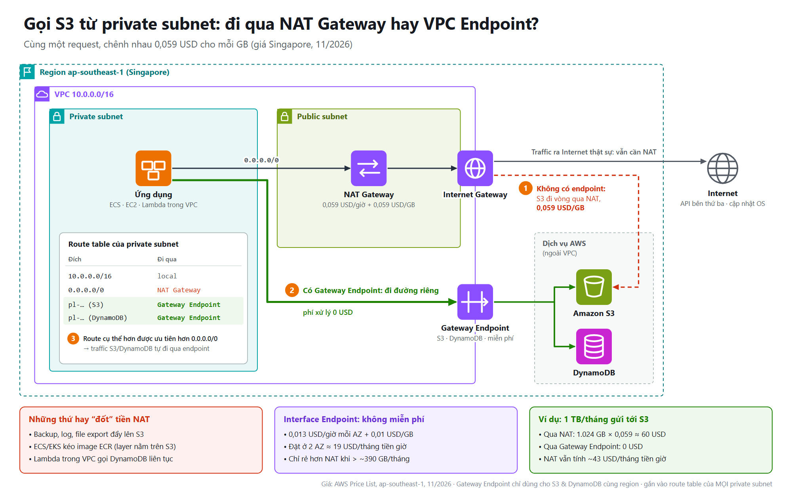

# A HUGE "NATGATEWAY-BYTES" LINE ON YOUR AWS BILL? YOU MAY BE PAYING TO CALL S3

> Posted in the AWS Study Group community: [original post](https://www.facebook.com/groups/660548818043427/?multi_permalinks=2341791103252515) · Author: Nguyen Tien Thanh

A common situation after moving an application into private subnets: everything works, but at the end of the month the NAT Gateway line on the bill is higher than the cost of running the application. The cause is usually not heavy Internet traffic. The culprit is traffic to AWS services themselves, such as S3, DynamoDB and ECR, taking a detour through the NAT Gateway.

This post explains what NAT Gateways and VPC Endpoints are, why adding a single route can remove that charge, and when you should not do it.

### 1. Basic concepts

- **Private subnet**: a subnet with no direct route to the Internet. Applications and databases live here so nobody on the Internet can reach them directly.
- **NAT Gateway**: the "exit door" of a private subnet. It sits in a public subnet and lets machines inside call out (download packages, call third-party APIs) while blocking calls coming in. A NAT Gateway is billed per hour **and** per GB of data processed.
- **VPC Endpoint**: a private path from the VPC to an AWS service that does not go through NAT or the Internet. Two common types:
  - **Gateway Endpoint**: only for S3 and DynamoDB. You just add a route to the route table. **Free.**
  - **Interface Endpoint (PrivateLink)**: for most other services (ECR, Secrets Manager, CloudWatch Logs, SQS…). It creates a network interface (ENI) in the subnet and is billed per hour per AZ and per GB.

### 2. The problem

S3 and DynamoDB live outside your VPC. Without an endpoint, a request from a private subnet to S3 goes application → NAT Gateway → Internet Gateway → public S3 endpoint. Every GB through the NAT is charged a processing fee.

The biggest NAT "burners":
- Backups, logs and exports pushed to S3.
- ECS/EKS pulling images from ECR (image layers actually live in S3).
- Lambda functions in a VPC reading/writing DynamoDB constantly.
- ETL jobs reading large data from S3.

### 3. Architecture (see the illustration at the top)

1. **Without an endpoint**: the default route `0.0.0.0/0 → NAT Gateway` sends S3 traffic through the NAT and the Internet Gateway too, at 0.059 USD per GB.
2. **With a Gateway Endpoint**: traffic to S3/DynamoDB takes a private path through the endpoint, with 0 USD processing fee.
3. **Why no code changes are needed**: the private route table gets a route `pl-xxxx` (the S3 prefix list) → Gateway Endpoint. A more specific route always wins over `0.0.0.0/0`, so S3 traffic switches to the endpoint automatically.

Traffic that really needs the Internet (third-party APIs, OS updates) still goes through the NAT Gateway as before.

### 4. Cost (Singapore region, AWS Price List, November 2026)

| Item | Price |
| --- | --- |
| NAT Gateway | 0.059 USD/hour (about 43 USD/month per NAT Gateway) + 0.059 USD per GB processed |
| Gateway Endpoint (S3, DynamoDB) | 0 USD |
| Interface Endpoint | 0.013 USD/hour per AZ (about 9.5 USD/month per AZ) + 0.01 USD/GB |

Example: an ECS cluster pushing logs/backups to S3 and pulling images, 1 TB per month through the NAT:
- **Before**: 1,024 GB × 0.059 ≈ 60 USD/month in processing fees alone.
- **After adding an S3 Gateway Endpoint**: that part drops to 0 USD.

Interface Endpoints need a calculation. One endpoint in 2 AZs costs about 19 USD/month in hourly fees. It only becomes cheaper than going through NAT when traffic exceeds about 19 / (0.059 − 0.01) ≈ 390 GB per month. Below that, let the NAT handle it, as long as you need the NAT for Internet access anyway.

For labs: delete the NAT Gateway when you finish. Left idle it still costs about 43 USD/month in hourly fees, plus the public IPv4 address attached to it.

### 5. Lessons learned

- **Gateway Endpoints attach to route tables.** If private subnets use different route tables, attach the endpoint to all of them. Miss one and that AZ still goes through the NAT.
- **Same region only.** It only covers S3/DynamoDB in the same region. Buckets in other regions still go through the NAT and add inter-region transfer fees.
- **Not usable from on-premises (VPN/Direct Connect) or VPC peering.** Those cases need an S3 Interface Endpoint.
- **Pulling ECR images from private subnets needs the full set**: Interface Endpoints `ecr.api` and `ecr.dkr`, the S3 Gateway Endpoint (layers live in S3), and `logs` if containers ship logs to CloudWatch.
- **Endpoints allow access to every bucket by default.** Write an endpoint policy that only allows your buckets. You can add a bucket policy with `aws:SourceVpce` so the bucket only accepts requests through the endpoint (careful not to lock yourself out of the console).
- **Dev/lab vs production.** In dev/lab one NAT Gateway is enough. In production, use one NAT Gateway per AZ so an AZ failure does not affect the others and you avoid cross-AZ transfer fees.

### 6. How to verify

- **Cost Explorer**: filter Usage Type `APS1-NatGateway-Bytes` (APS1 = Singapore) and compare before and after adding the endpoint.
- **CloudWatch**: the NAT Gateway metric `BytesOutToDestination` should drop clearly.
- **VPC Flow Logs**: check whether traffic to S3 IP ranges still goes through the NAT's network interface.
- **Test environment**: temporarily remove the `0.0.0.0/0` route and run `aws s3 ls --region ap-southeast-1` from a private-subnet machine. If it still works, traffic is going through the endpoint.

### Summary in 3 lines

- NAT Gateways charge per GB, even when you are only calling S3.
- S3 and DynamoDB have free Gateway Endpoints; just add them to the route table.
- Interface Endpoints have hourly fees, so calculate the break-even point before enabling them everywhere.

### References

- Gateway endpoints: <https://docs.aws.amazon.com/vpc/latest/privatelink/gateway-endpoints.html>
- Gateway endpoints for S3: <https://docs.aws.amazon.com/vpc/latest/privatelink/vpc-endpoints-s3.html>
- NAT Gateway pricing: <https://docs.aws.amazon.com/vpc/latest/userguide/nat-gateway-pricing.html>
- PrivateLink pricing (Interface Endpoints): <https://aws.amazon.com/privatelink/pricing/>
- VPC endpoints for ECR: <https://docs.aws.amazon.com/AmazonECR/latest/userguide/vpc-endpoints.html>

*Note: prices come from the AWS Price List for Singapore (ap-southeast-1), November 2026; other regions differ. The 1 TB/month example is an assumption used to illustrate the calculation.*
