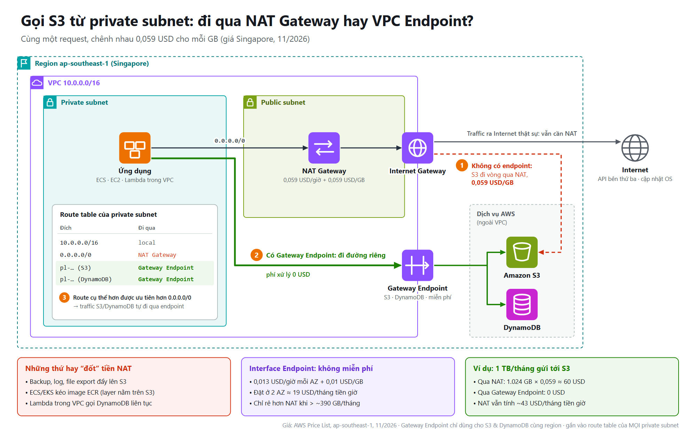

# HOÁ ĐƠN AWS CÓ DÒNG "NATGATEWAY-BYTES" TO BẤT THƯỜNG? CÓ THỂ BẠN ĐANG TRẢ TIỀN ĐỂ GỌI S3

> Bài viết đã đăng trên nhóm AWS Study Group: [xem bài gốc](https://www.facebook.com/groups/660548818043427/?multi_permalinks=2341791103252515) · Tác giả: Nguyễn Tiến Thành

Một tình huống khá phổ biến khi mới đưa ứng dụng vào private subnet: mọi thứ chạy đúng, nhưng cuối tháng dòng NAT Gateway trong hoá đơn lại cao hơn cả tiền chạy ứng dụng. Nguyên nhân thường không phải do gọi Internet nhiều. Thủ phạm là traffic tới chính các dịch vụ AWS như S3, DynamoDB, ECR đang đi vòng qua NAT Gateway.

Bài này giải thích NAT Gateway và VPC Endpoint là gì, vì sao chỉ cần thêm một route là cắt được khoản phí đó, và khi nào không nên làm.

### 1. Khái niệm cơ bản

- Private subnet: subnet không có đường đi trực tiếp ra Internet. Ứng dụng và database đặt ở đây để không ai từ Internet gọi thẳng vào được.
- NAT Gateway: "cửa ra" của private subnet. Nó nằm trong public subnet, cho máy bên trong gọi ra ngoài (tải package, gọi API bên thứ ba) nhưng không cho bên ngoài gọi vào. NAT Gateway tính tiền theo giờ VÀ theo từng GB dữ liệu đi qua.
- VPC Endpoint: đường đi riêng từ VPC tới dịch vụ AWS, không qua NAT, không ra Internet. Có hai loại hay dùng:
  - Gateway Endpoint: chỉ dành cho S3 và DynamoDB. Chỉ cần thêm một route vào route table. Miễn phí.
  - Interface Endpoint (PrivateLink): dành cho hầu hết dịch vụ còn lại (ECR, Secrets Manager, CloudWatch Logs, SQS…). Nó tạo một network interface (ENI) trong subnet, tính tiền theo giờ ở mỗi AZ và theo GB.

### 2. Vấn đề

S3 và DynamoDB nằm ngoài VPC của bạn. Nếu không có endpoint, request từ private subnet tới S3 đi theo đường: ứng dụng → NAT Gateway → Internet Gateway → endpoint công khai của S3. Mỗi GB đi qua NAT đều bị tính phí xử lý.

Những thứ hay "đốt" tiền NAT nhất:
- Backup, log, file export đẩy lên S3.
- ECS/EKS kéo image từ ECR (các layer của image thực chất nằm trên S3).
- Lambda trong VPC đọc/ghi DynamoDB liên tục.
- Job ETL đọc dữ liệu lớn từ S3.

### 3. Kiến trúc (xem ảnh minh hoạ ở đầu bài)

① Khi chưa có endpoint: route mặc định 0.0.0.0/0 → NAT Gateway đưa cả traffic tới S3 đi vòng qua NAT và Internet Gateway. Mỗi GB tốn 0,059 USD.
② Khi có Gateway Endpoint: traffic tới S3/DynamoDB đi đường riêng qua endpoint. Phí xử lý: 0 USD.
③ Vì sao không cần sửa code? Route table của private subnet có thêm route pl-xxxx (prefix list của S3) → Gateway Endpoint. Route cụ thể hơn luôn được ưu tiên hơn 0.0.0.0/0, nên traffic tới S3 tự chuyển sang endpoint.

Traffic thật sự cần ra Internet (API bên thứ ba, cập nhật hệ điều hành) vẫn đi qua NAT Gateway như cũ.

### 4. Chi phí (region Singapore, AWS Price List tháng 11/2026)

- NAT Gateway: 0,059 USD/giờ (khoảng 43 USD/tháng cho mỗi NAT Gateway) + 0,059 USD cho mỗi GB xử lý.
- Gateway Endpoint (S3, DynamoDB): 0 USD.
- Interface Endpoint: 0,013 USD/giờ cho mỗi AZ (khoảng 9,5 USD/tháng/AZ) + 0,01 USD/GB.

Ví dụ: một cụm ECS đẩy log/backup lên S3 và kéo image, tổng cộng 1 TB mỗi tháng đi qua NAT:
- Trước: 1.024 GB × 0,059 ≈ 60 USD/tháng, chỉ riêng phí xử lý.
- Sau khi thêm S3 Gateway Endpoint: phần này về 0 USD.

Interface Endpoint thì phải tính kỹ. Một endpoint đặt ở 2 AZ tốn khoảng 19 USD/tháng tiền giờ. Nó chỉ rẻ hơn đi qua NAT khi lưu lượng qua nó lớn hơn khoảng 19 / (0,059 − 0,01) ≈ 390 GB mỗi tháng. Ít hơn mức đó thì cứ để NAT xử lý, với điều kiện đằng nào bạn cũng cần NAT để ra Internet.

Với lab: học xong nhớ xoá NAT Gateway. Để không dùng thì mỗi tháng vẫn mất khoảng 43 USD tiền giờ, chưa kể tiền địa chỉ IPv4 công khai gắn vào nó.

### 5. Rút kinh nghiệm

- Gateway Endpoint gắn theo route table. VPC có nhiều private subnet dùng route table khác nhau thì phải gắn endpoint vào đủ các route table. Quên một cái là AZ đó vẫn đi qua NAT.
- Chỉ áp dụng cho S3/DynamoDB trong cùng region. Bucket ở region khác vẫn đi qua NAT, và còn bị tính thêm phí truyền dữ liệu giữa các region.
- Không dùng được từ on-premises (VPN/Direct Connect) hay từ VPC peering. Trường hợp đó cần Interface Endpoint cho S3.
- Kéo image ECR từ private subnet cần đủ bộ: Interface Endpoint ecr.api và ecr.dkr, S3 Gateway Endpoint (vì layer nằm trên S3), thêm logs nếu container gửi log lên CloudWatch.
- Endpoint mặc định cho phép truy cập mọi bucket. Nên viết endpoint policy chỉ cho phép bucket của mình. Có thể thêm bucket policy dùng điều kiện aws:SourceVpce để bucket chỉ nhận request đi qua endpoint (cẩn thận kẻo tự khoá mình khỏi console).
- Dev/lab: một NAT Gateway là đủ. Production nên đặt mỗi AZ một NAT Gateway để một AZ gặp sự cố không kéo theo các AZ khác, đồng thời tránh phí truyền dữ liệu giữa các AZ.

### 6. Kiểm chứng thế nào?

- Cost Explorer: lọc Usage Type APS1-NatGateway-Bytes (APS1 là Singapore), so sánh trước và sau khi thêm endpoint.
- CloudWatch: metric BytesOutToDestination của NAT Gateway phải giảm rõ rệt.
- VPC Flow Logs: kiểm tra traffic tới dải IP của S3 còn đi qua network interface của NAT nữa không.
- Trong môi trường test: tạm gỡ route 0.0.0.0/0 rồi chạy lệnh "aws s3 ls --region ap-southeast-1" từ máy trong private subnet. Vẫn chạy được nghĩa là traffic đã đi qua endpoint.

### Tóm tắt 3 dòng

- NAT Gateway tính tiền theo từng GB, kể cả khi bạn chỉ gọi S3.
- S3 và DynamoDB có Gateway Endpoint miễn phí, chỉ cần thêm vào route table.
- Interface Endpoint có phí theo giờ: tính điểm hoà vốn trước khi bật hàng loạt.

Dòng nào trong hoá đơn AWS từng làm các bạn bất ngờ nhất? Mình đoán NAT Gateway nằm trong top 3. Chia sẻ ở comment nhé.

### Tài liệu tham khảo

- Gateway Endpoint: <https://docs.aws.amazon.com/vpc/latest/privatelink/gateway-endpoints.html>
- Gateway Endpoint cho S3: <https://docs.aws.amazon.com/vpc/latest/privatelink/vpc-endpoints-s3.html>
- Cách tính phí NAT Gateway: <https://docs.aws.amazon.com/vpc/latest/userguide/nat-gateway-pricing.html>
- Bảng giá PrivateLink (Interface Endpoint): <https://aws.amazon.com/privatelink/pricing/>
- VPC Endpoint cho ECR: <https://docs.aws.amazon.com/AmazonECR/latest/userguide/vpc-endpoints.html>

Lưu ý: giá lấy từ AWS Price List region Singapore (ap-southeast-1) tháng 11/2026, region khác sẽ khác. Ví dụ 1 TB/tháng là số giả định để minh hoạ cách tính.

`#AWS` `#AmazonVPC` `#NATGateway` `#VPCEndpoint` `#CostOptimization` `#AWSStudyGroup` `#FirstCloudJourney`
