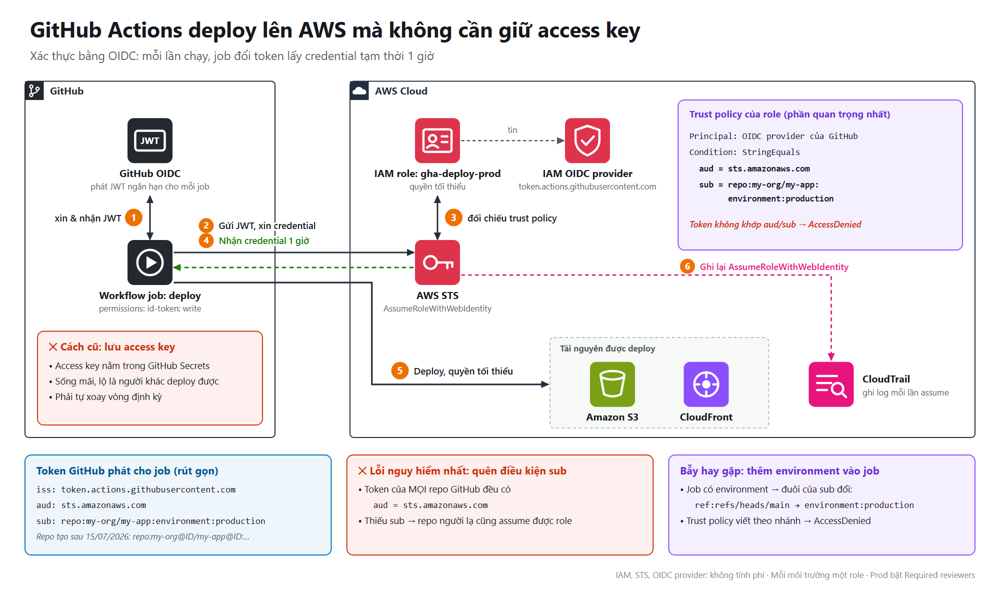

# STILL PASTING AWS ACCESS KEYS INTO GITHUB SECRETS? LET YOUR CI HOLD NO KEYS AT ALL

> Posted in the AWS Study Group community: [original post](https://www.facebook.com/groups/660548818043427/?multi_permalinks=2342465539851738) · Author: Nguyen Tien Thanh



The quickest way to let GitHub Actions deploy to AWS is to create an IAM user, generate an access key and paste it into GitHub Secrets. It works immediately. The problem is that the key lives until you delete it. If it leaks once (through a log, an accidentally committed `.env`, or malware on a developer machine), someone else can deploy exactly like your CI.

This post introduces the alternative: GitHub Actions requests **temporary credentials** from AWS through **OIDC**. You will learn how the flow works, how to write the trust policy, and the most dangerous misconfiguration to avoid.

### 1. Basic concepts

- **OIDC (OpenID Connect)** is a standard for a system to prove "who I am" with a signed token (JWT). Here GitHub issues the token and AWS verifies it.
- **The GitHub token**: on every job run, GitHub issues a short-lived token that states which repo, branch and environment it belongs to (the `sub` claim) and who it is for (`aud = sts.amazonaws.com`).
- **AWS STS** (Security Token Service) receives the token, checks the signature and the conditions in the IAM role's trust policy, and returns temporary credentials (expiring after 1 hour by default).
- **Result**: no keys are stored in GitHub, so there is nothing to leak and nothing to rotate.

### 2. Architecture (see the illustration at the top)

**One-time setup:**
- Create an IAM OIDC identity provider with URL `token.actions.githubusercontent.com` and audience `sts.amazonaws.com`.
- Create an IAM role for deployment. Its trust policy only trusts tokens from the right repo and the right branch/environment. Its permissions are minimal (for example, write to one bucket and create CloudFront invalidations).

**On every deployment:**
1. The job declares `id-token: write` and asks GitHub for an OIDC token (JWT).
2. The action `aws-actions/configure-aws-credentials` sends the token to STS (`AssumeRoleWithWebIdentity`).
3. STS checks the trust policy: is the token signed by GitHub? Is `aud` correct? Does `sub` match the repo/environment?
4. If valid, STS returns temporary credentials that expire after 1 hour.
5. The job deploys (S3, ECS, CDK, Terraform…) with exactly the role's permissions and nothing more.
6. CloudTrail records every `AssumeRoleWithWebIdentity`, so you can trace where each deployment came from.

The workflow part:

```yaml
permissions:
  id-token: write
  contents: read

steps:
  - uses: aws-actions/configure-aws-credentials@v6
    with:
      role-to-assume: arn:aws:iam::<ACCOUNT_ID>:role/gha-deploy-prod
      aws-region: ap-southeast-1
```

The most important part is the condition in the role's trust policy:

```json
"Condition": {
  "StringEquals": {
    "token.actions.githubusercontent.com:aud": "sts.amazonaws.com",
    "token.actions.githubusercontent.com:sub": "repo:my-org/my-app:environment:production"
  }
}
```

### 3. Cost

IAM, the OIDC provider and STS are free. What you save is effort: no periodic key rotation and no scrambling to revoke keys whenever you suspect a leak. A leaked high-privilege access key costs more than any line on your bill; having it used to mine crypto on your account is a very familiar story.

### 4. The most dangerous mistake: an overly broad trust policy

Tokens from every repository on GitHub carry `aud = sts.amazonaws.com`. If your trust policy checks `aud` but not `sub`, then in theory any repo on GitHub can assume your role, including a stranger's.

- **Production roles**: lock `sub` to the exact repo and environment, preferably with `StringEquals`.
- **No broad wildcards**: avoid patterns like `repo:*` for important roles.
- **Old roles**: review the trust policy of roles created long ago or copied from old tutorials.

### 5. Lessons learned: common traps

- **Adding an environment changes `sub`.** When a job declares `environment: production`, the end of `sub` changes from `ref:refs/heads/main` to `environment:production`. A trust policy written for the branch then fails with "Not authorized to perform sts:AssumeRoleWithWebIdentity". This error is very common.
- **Newer repositories use a different `sub` format with IDs**, for example `repo:my-org@123456/my-app@456789:ref:refs/heads/main`. Renaming or transferring a repo can also switch it to the new format. Trust policies copied from old guides will not match and return AccessDenied. Write the condition for the format your repo actually uses.
- **One role per environment.** The dev role can trust several branches but with narrow permissions. The prod role only trusts the `production` environment, with Required reviewers enabled in the GitHub Environment.
- **Pull requests have their own `sub`** (`repo:my-org/my-app:pull_request` in the old format). Do not let a prod role trust it, and be careful with `pull_request_target`, which runs with the base repo's privileges.
- **OIDC solves key storage, not over-permissioning.** The role must still follow least privilege.
- **Clean up after migrating.** Once you switch to OIDC, delete the old access keys and IAM users. Check the "Last used" column in IAM first.
- **Keep secret scanning** (gitleaks, GitHub secret scanning) for other kinds of secrets.

### 6. How to verify

- **Right environment**: running the workflow from the right environment assumes the role successfully, and `aws sts get-caller-identity` prints role `gha-deploy-prod`.
- **Wrong branch or PR**: running the same workflow from another branch or a pull request must be denied.
- **Audit**: in CloudTrail, find `AssumeRoleWithWebIdentity` events to see which repo assumed the role and when.

### Summary in 3 lines

- With OIDC, GitHub proves identity and AWS issues 1-hour credentials, so there are no keys to store.
- The trust policy must lock both `aud` and `sub`; without `sub`, every repo can get in.
- Use one role per environment with least privilege, and require a reviewer for prod.

### References

- GitHub: configuring OIDC in AWS: <https://docs.github.com/en/actions/how-tos/secure-your-work/security-harden-deployments/oidc-in-aws>
- GitHub: OIDC concepts and claims: <https://docs.github.com/en/actions/concepts/security/openid-connect>
- AWS: creating an OIDC identity provider: <https://docs.aws.amazon.com/IAM/latest/UserGuide/id_roles_providers_create_oidc.html>
- AWS: creating a role for OIDC federation: <https://docs.aws.amazon.com/IAM/latest/UserGuide/id_roles_create_for-idp_oidc.html>
- configure-aws-credentials action: <https://github.com/aws-actions/configure-aws-credentials>

*Note: this is a reference architecture and configuration; the repo, role and account names are examples.*
