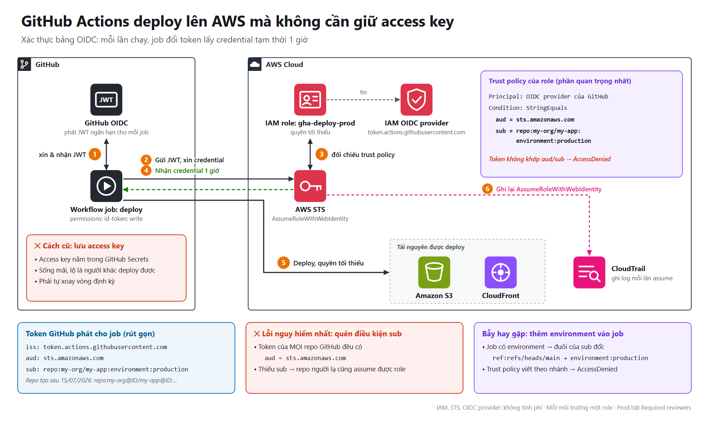

# VẪN DÁN ACCESS KEY AWS VÀO GITHUB SECRETS? CÓ CÁCH ĐỂ CI KHÔNG PHẢI GIỮ KEY NÀO

> Bài viết đã đăng trên nhóm AWS Study Group: [xem bài gốc](https://www.facebook.com/groups/660548818043427/?multi_permalinks=2342465539851738) · Tác giả: Nguyễn Tiến Thành



Cách nhanh nhất để GitHub Actions deploy được lên AWS: tạo một IAM user, sinh access key, dán vào GitHub Secrets. Chạy được ngay. Vấn đề là cặp key đó sống mãi cho tới khi bạn tự xoá. Chỉ cần lộ ra một lần (qua log, file .env commit nhầm, máy dev bị nhiễm mã độc) là người khác có quyền deploy y như CI của bạn.

Bài này giới thiệu cách thay thế: GitHub Actions xin credential tạm thời từ AWS thông qua OIDC. Đọc xong, bạn sẽ hiểu luồng hoạt động, trust policy cần viết thế nào và lỗi cấu hình nguy hiểm nhất cần tránh.


### 1. Khái niệm cơ bản


- OIDC (OpenID Connect) là chuẩn để một hệ thống chứng minh "tôi là ai" bằng một token có chữ ký (JWT). Ở đây GitHub là bên phát token, AWS là bên kiểm tra.
- Mỗi lần job chạy, GitHub phát một token ngắn hạn, ghi rõ token này của repo nào, nhánh nào, environment nào (claim sub) và dành cho ai (claim aud = sts.amazonaws.com).
- AWS STS (Security Token Service) nhận token, kiểm tra chữ ký và các điều kiện trong trust policy của IAM role, rồi trả về credential tạm thời (mặc định hết hạn sau 1 giờ).
- Kết quả: không còn key nào nằm trong GitHub. Không có gì để lộ, cũng không có gì phải xoay vòng.


### 2. Kiến trúc (xem ảnh minh hoạ ở đầu bài)


Thiết lập một lần:
- Tạo IAM OIDC identity provider với URL token.actions.githubusercontent.com và audience sts.amazonaws.com.
- Tạo IAM role dùng để deploy. Trust policy chỉ tin token của đúng repo và đúng nhánh/environment. Quyền gắn cho role ở mức tối thiểu (ví dụ chỉ được ghi vào một bucket và tạo CloudFront invalidation).

Mỗi lần deploy:
① Job khai báo "id-token: write" và xin GitHub một token OIDC (JWT).
② Action aws-actions/configure-aws-credentials gửi token đó tới STS (gọi AssumeRoleWithWebIdentity).
③ STS đối chiếu với trust policy: token có đúng do GitHub ký không? aud có đúng không? sub có khớp repo/environment không?
④ Hợp lệ thì STS trả về credential tạm thời, hết hạn sau 1 giờ.
⑤ Job deploy (S3, ECS, CDK, Terraform…) với đúng quyền của role, không hơn.
⑥ CloudTrail ghi lại mỗi lần AssumeRoleWithWebIdentity, nên tra được lần deploy nào đến từ đâu.

Phần workflow:


```yaml
permissions:
  id-token: write
  contents: read

steps:
  - uses: aws-actions/configure-aws-credentials@v6
    with:
      role-to-assume: arn:aws:iam::<ACCOUNT_ID>:role/gha-deploy-prod
      aws-region: ap-southeast-1
```


Phần quan trọng nhất là điều kiện trong trust policy của role:


```json
"Condition": {
  "StringEquals": {
    "token.actions.githubusercontent.com:aud": "sts.amazonaws.com",
    "token.actions.githubusercontent.com:sub": "repo:my-org/my-app:environment:production"
  }
}
```


### 3. Chi phí


IAM, OIDC provider và STS đều không tính phí. Cái bạn tiết kiệm được là công sức: không phải định kỳ xoay vòng key, không phải chạy đi thu hồi key mỗi khi nghi bị lộ. Và một access key quyền cao bị lộ còn tốn hơn mọi dòng trong hoá đơn (bị dùng để đào coin trên tài khoản của bạn là kịch bản rất quen).


### 4. Lỗi nguy hiểm nhất: trust policy quá rộng


Token của mọi repo trên GitHub đều có aud = sts.amazonaws.com. Nếu trust policy chỉ kiểm tra aud mà không kiểm tra sub, thì về lý thuyết bất kỳ repo nào trên GitHub cũng assume được role của bạn, kể cả repo của người lạ.

- Role có quyền production: khoá sub đúng repo + đúng environment, ưu tiên StringEquals.
- Không dùng wildcard rộng như repo:* cho role quan trọng.
- Role tạo từ lâu hoặc copy từ hướng dẫn cũ: nên rà lại trust policy.


### 5. Rút kinh nghiệm: những bẫy hay gặp


- Thêm environment là sub đổi đuôi. Khi job khai báo "environment: production", phần cuối của sub đổi từ ref:refs/heads/main thành environment:production. Trust policy viết theo nhánh sẽ báo lỗi "Not authorized to perform sts:AssumeRoleWithWebIdentity". Lỗi này rất hay gặp.
- Repo tạo sau 15/07/2026 dùng định dạng sub mới, có gắn ID. Ví dụ: repo:my-org@123456/my-app@456789:ref:refs/heads/main. Repo đổi tên hoặc chuyển chủ sau ngày này cũng chuyển sang định dạng mới. Copy trust policy từ hướng dẫn cũ sẽ không khớp → AccessDenied. Viết điều kiện theo đúng định dạng repo của bạn đang dùng.
- Mỗi môi trường một role. Role dev có thể cho nhiều nhánh nhưng quyền hẹp. Role prod chỉ tin environment production, bật Required reviewers trong GitHub Environment để có người duyệt trước khi deploy.
- Pull request có sub riêng (repo:my-org/my-app:pull_request theo định dạng cũ). Đừng để role prod tin claim này. Cẩn thận với pull_request_target, vì workflow đó chạy với quyền của repo gốc.
- OIDC giải quyết chuyện giữ key, không giải quyết chuyện quyền quá rộng. Role vẫn phải theo nguyên tắc quyền tối thiểu.
- Chuyển sang OIDC xong thì xoá access key cũ và IAM user cũ. Xem cột "Last used" trong IAM để chắc không còn ai dùng.
- Vẫn giữ secret scanning (gitleaks, GitHub secret scanning) cho các loại secret khác.


### 6. Kiểm chứng thế nào?


- Chạy workflow từ đúng environment → assume thành công; lệnh "aws sts get-caller-identity" in ra role gha-deploy-prod.
- Chạy cùng workflow từ một nhánh khác hoặc từ pull request → phải bị từ chối.
- Mở CloudTrail, tìm sự kiện AssumeRoleWithWebIdentity để xem repo nào đã assume role và vào lúc nào.


### Tóm tắt 3 dòng


- OIDC: GitHub chứng minh danh tính, AWS cấp credential 1 giờ. Không có key nào phải lưu.
- Trust policy phải khoá cả aud và sub. Thiếu sub là mở cửa cho mọi repo.
- Mỗi môi trường một role, quyền tối thiểu, prod có người duyệt.

Dự án của các bạn đang deploy lên AWS từ đâu: GitHub Actions, GitLab CI hay CodePipeline? Đã bỏ được access key chưa? Chia sẻ ở comment nhé.


### Tài liệu tham khảo


- GitHub: cấu hình OIDC với AWS: <https://docs.github.com/en/actions/how-tos/secure-your-work/security-harden-deployments/oidc-in-aws>
- GitHub: khái niệm OIDC và các claim: <https://docs.github.com/en/actions/concepts/security/openid-connect>
- AWS: tạo OIDC identity provider: <https://docs.aws.amazon.com/IAM/latest/UserGuide/id_roles_providers_create_oidc.html>
- AWS: tạo role cho OIDC federation: <https://docs.aws.amazon.com/IAM/latest/UserGuide/id_roles_create_for-idp_oidc.html>
- Action configure-aws-credentials: <https://github.com/aws-actions/configure-aws-credentials>

Lưu ý: đây là kiến trúc và cấu hình tham khảo, tên repo, role và account trong bài là ví dụ.


`#AWS` `#GitHubActions` `#OIDC` `#IAM` `#DevSecOps` `#CICD` `#AWSStudyGroup` `#FirstCloudJourney`
