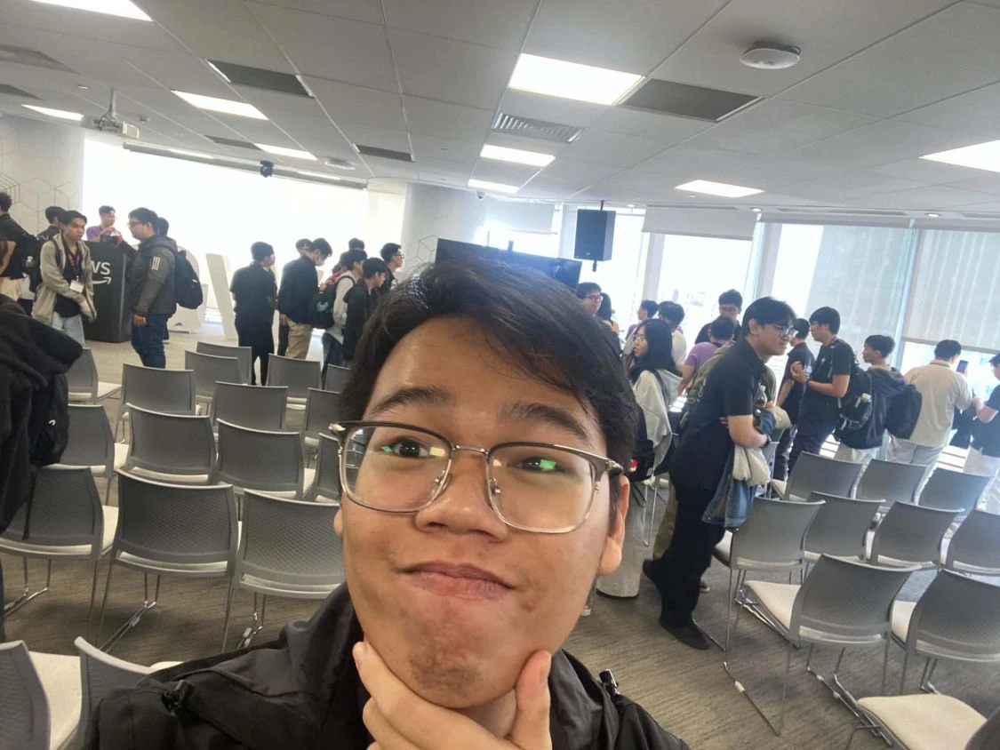

# EVENT REPORT: "BUILDRATHON KICKOFF: CODE THE FUTURE WITH CMC GLOBAL"

### Event information
- **Date & time:** 09:00 – 12:00, Saturday 09/26/2026
- **Location:** AWS office, 26th floor, Bitexco Financial Tower, 2 Hai Trieu, Ho Chi Minh City
- **Organizers:** First Cloud AI Journey (FCAJ) with CMC Global
- **My role:** Attendee (week 2 of my internship)

### Purpose of the event
- Kick off the **Buildathon** challenge: goals, rules and judging criteria.
- Introduce AWS Cloud, Generative AI and how AI agents are built with AWS services.
- Connect students and interns with people working in Cloud & AI.

### Agenda
| Time | Content |
| --- | --- |
| 09:00 – 09:30 | Buildathon kickoff: goals, rules, judging criteria; overview of AWS Cloud, GenAI, AI agents |
| 09:30 – 09:45 | Ice-breaking: meeting participants, sharing interests in AWS and AI, preparing to form teams |
| 09:45 – 10:30 | Talk show "Building a Career in Cloud & AI" |
| 10:30 – 10:45 | Q&A on AWS, GenAI, certifications and the Buildathon |
| 10:45 – 11:15 | Hands-on: AI Agent Challenge |
| 11:15 – 11:20 | Wrap-up, learning resources and upcoming community activities |

### Highlights
**AI agents on AWS**
- The difference between a chatbot that answers questions and an **AI agent**: an agent is given tools, data and permissions to take actions on its own.
- Building blocks: prompt engineering, **RAG** (retrieve documents, then generate), **knowledge bases**, and multi-step agent orchestration.

**Career talk show**
- Companies use AWS and agentic AI to solve real business problems, not just for demos.
- Career path: fundamentals (Linux, networking, programming) → core AWS services → specialize in one area (DevOps, Security, Data/AI). Certifications help you learn systematically, but real projects are what prove your skills.

**Hands-on AI Agent Challenge**
- A short mentor-guided exercise building an AI-powered solution: writing prompts, attaching a data source (RAG/knowledge base) and letting the agent call tools.

### What I learned
- **An agent must be governed like an identity.** Once AI can call APIs, the key security question is which identity the agent uses, what it may do, and who is accountable. This matches my DevSecOps role: least privilege applies to agents as well as people.
- **RAG makes answers verifiable.** Answers grounded in retrieved documents are easier to check than answers the model "remembers".
- **Learning direction.** In week 2, the talk show helped me order my learning: strengthen AWS fundamentals (IAM, VPC, compute, storage) first, then go deeper into IaC and security.

### Applying it to my work
- Set a learning plan: finish the FCJ fundamentals workshops in the first 4–5 weeks, then study Terraform and security for the team project.
- Noted an idea for later: use a read-only AI agent with minimal IAM permissions to review the project's AWS configuration.

### Event experience
This was my first event at the AWS office. The 26th-floor room was packed, so many attendees had to be checked in by hand at the door. The atmosphere was open, and the mentors were happy to answer even very basic questions from beginners.

### Event photos

### Key takeaway
To do AI on the cloud properly, you need solid cloud and security fundamentals first. However powerful an agent is, it is only safe when its identity, permissions and data are designed carefully.
