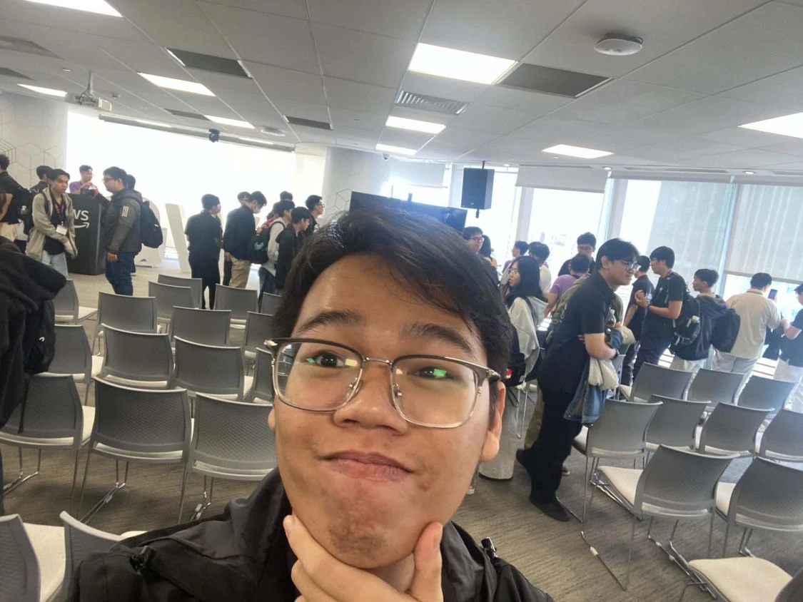

# BÀI THU HOẠCH "BUILDRATHON KICKOFF: CODE THE FUTURE WITH CMC GLOBAL"

### Thông tin sự kiện
- **Thời gian:** 09:00 – 12:00, Thứ Bảy 26/09/2026
- **Địa điểm:** Văn phòng AWS, tầng 26, Bitexco Financial Tower, 2 Hải Triều, TP.HCM
- **Đơn vị tổ chức:** First Cloud AI Journey (FCAJ) phối hợp CMC Global
- **Vai trò của em:** Người tham dự (tuần thứ 2 của kỳ thực tập)

### Mục đích của sự kiện
- Khởi động thử thách **Buildathon**: giới thiệu mục tiêu, thể lệ và tiêu chí chấm.
- Giới thiệu tổng quan AWS Cloud, Generative AI và cách xây AI Agent bằng dịch vụ AWS.
- Kết nối các bạn sinh viên, thực tập sinh với người đang làm nghề Cloud & AI.

### Chương trình
| Thời gian | Nội dung |
| --- | --- |
| 09:00 – 09:30 | Buildathon Kickoff: mục tiêu, thể lệ, tiêu chí chấm; tổng quan AWS Cloud, GenAI, AI Agent |
| 09:30 – 09:45 | Ice-breaking: làm quen, chia sẻ quan tâm về AWS và AI, chuẩn bị ghép đội |
| 09:45 – 10:30 | Talkshow "Building a Career in Cloud & AI" |
| 10:30 – 10:45 | Q&A về AWS, GenAI, chứng chỉ và thử thách Buildathon |
| 10:45 – 11:15 | Hands-on: AI Agent Challenge |
| 11:15 – 11:20 | Tổng kết, tài liệu học và hoạt động cộng đồng sắp tới |

### Nội dung nổi bật
**AI Agent trên AWS**
- Phân biệt chatbot trả lời câu hỏi với **AI Agent**: agent được cấp công cụ (tools), dữ liệu và quyền để tự thực hiện hành động.
- Các khối xây dựng: prompt engineering, **RAG** (truy xuất tài liệu rồi mới sinh câu trả lời), **Knowledge Base**, và agent điều phối nhiều bước.

**Talkshow nghề Cloud & AI**
- Doanh nghiệp đang ứng dụng AWS và Agentic AI để giải bài toán kinh doanh thật, không chỉ làm demo.
- Lộ trình nghề nghiệp: nền tảng (Linux, mạng, lập trình) → dịch vụ AWS cốt lõi → chuyên sâu một mảng (DevOps, Security, Data/AI); chứng chỉ giúp học có hệ thống, nhưng dự án thực tế mới là thứ chứng minh năng lực.

**Hands-on AI Agent Challenge**
- Thực hành một bài nhỏ dựng giải pháp có AI theo hướng dẫn của mentor: viết prompt, gắn nguồn dữ liệu (RAG/knowledge base) và để agent gọi công cụ.

### Những gì em học được
- **Agent cần được quản lý như một danh tính.** Khi AI được cấp quyền gọi API thì câu hỏi bảo mật quan trọng nhất là: agent đang dùng danh tính nào, được làm gì và ai chịu trách nhiệm. Điều này khớp với vai trò DevSecOps của em: nguyên tắc quyền tối thiểu áp dụng cho cả agent, không chỉ cho người.
- **RAG giúp câu trả lời có căn cứ.** Câu trả lời dựa trên tài liệu được truy xuất dễ kiểm chứng hơn câu trả lời "nhớ" từ model.
- **Định hướng học.** Ở tuần thứ 2, buổi talkshow giúp em xác định thứ tự học: củng cố nền tảng AWS (IAM, VPC, compute, storage) trước, rồi mới đi sâu vào IaC và bảo mật.

### Ứng dụng vào công việc
- Đặt mục tiêu học theo lộ trình: hoàn thành các workshop nền tảng của FCJ trong 4–5 tuần đầu, sau đó học Terraform và bảo mật để phục vụ dự án nhóm.
- Ghi nhận ý tưởng: sau này có thể dùng AI Agent ở chế độ chỉ đọc (read-only) để rà soát cấu hình AWS của dự án, với quyền IAM tối thiểu.

### Trải nghiệm trong sự kiện
Đây là sự kiện đầu tiên em tham gia tại văn phòng AWS. Phòng tầng 26 rất đông, vì quá nhiều người nên khâu check-in ở cổng phải làm thủ công. Không khí cởi mở, các anh chị mentor sẵn sàng trả lời cả những câu hỏi rất cơ bản của sinh viên mới bắt đầu.

### Hình ảnh tham gia sự kiện

### Bài học rút ra
Muốn làm AI trên cloud cho đúng thì phải vững nền tảng cloud và bảo mật trước. Agent mạnh tới đâu cũng chỉ an toàn khi danh tính, quyền hạn và dữ liệu của nó được thiết kế cẩn thận.
