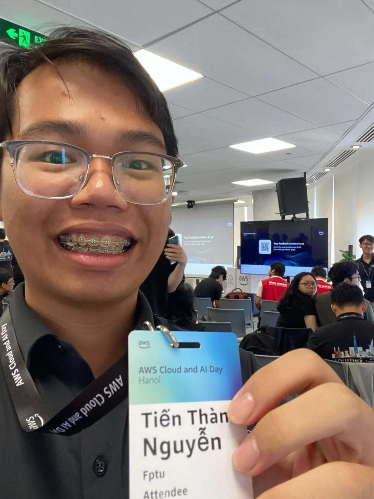

# EVENT REPORT: "AWS CLOUD AND AI DAY HANOI 2026"

### Event information
- **Date & time:** 08:00 – 17:00, Tuesday 09/29/2026
- **Location:** Watch party at the AWS HCMC office, 26th and 36th floors, Bitexco Financial Tower. The main event took place at JW Marriott Hotel Hanoi.
- **Organizer:** Amazon Web Services Vietnam
- **My role:** Attendee (registered on the official AWS event site, received an Attendee badge)

### Purpose of the event
- AWS's largest Cloud & AI event of the year in Vietnam, bringing together business leaders, partners, engineers and the builder community.
- Show how AWS and its customers use agentic systems to empower developers, modernize applications and secure organizations.
- Breakout sessions on agentic AI, data and analytics, migration, industry solutions and modern application development.

### Highlights
**From adoption to operational maturity**
- The question is no longer whether to use cloud/AI, but how to run it in production: clear ownership, access boundaries, observability, resilience, cost governance and security controls.

**Agentic AI as the main theme**
- Agents supporting coding, modernization, migration and business workflow automation.
- Once AI moves from generating content to taking actions (calling APIs, changing code, triggering deployments), it becomes a question of **identity, authorization, approval and auditing**.

**Platform engineering is still the foundation**
- AI makes teams faster, but staying safe at that speed requires a platform with built-in guardrails: consistent deployment patterns, secure defaults, policies, observability and software supply-chain controls.

**Workload (non-human) identity**
- CI/CD pipelines, serverless functions, containers and AI agents all need their own identities to call AWS. Good practice: short-lived credentials, federation, tight trust policies and continuous verification.

**AWS infrastructure in Vietnam and the ecosystem**
- AWS Direct Connect in Hanoi and the Hanoi Local Zone add options for low latency, private connectivity and local data.
- Customer stories (such as TCBS) showed AI changing how engineering teams work, not just adding another tool.
- Community figures: over 157,000 people trained in cloud & AI, over 54,000 AWS Study Group members, and over 15,000 participants in the First Cloud AI Journey ecosystem.

### What I learned
- **Machine identity matters as much as human identity.** This pushed me to look into GitHub Actions deploying with OIDC instead of access keys, which later became our team's third blog post.
- **Guardrails must come before speed.** Our team's DevSecOps pipeline (gitleaks, Checkov, Trivy, Bandit, IaC tests, blocking CI) is exactly the kind of platform guardrail the sessions described.
- **Architecture choices must consider operations and cost**, not just whether something works.

### Applying it to my work
- Build "short-lived credentials, least privilege" into the design: one IAM role per Lambda, and CI moving toward OIDC.
- Treat security as part of the platform rather than a final check (shift-left).

### Event experience
This was the first time I followed a full day of a major AWS event. Even watching on screens at the HCMC office, the atmosphere was lively. I also talked with other interns about how each team chose its topic and architecture.

### Event photos

### Key takeaway
Moving cloud and AI from demos to production needs three things: clear identities for both people and machines, a platform with safety guardrails, and concrete measurements of value and cost.
