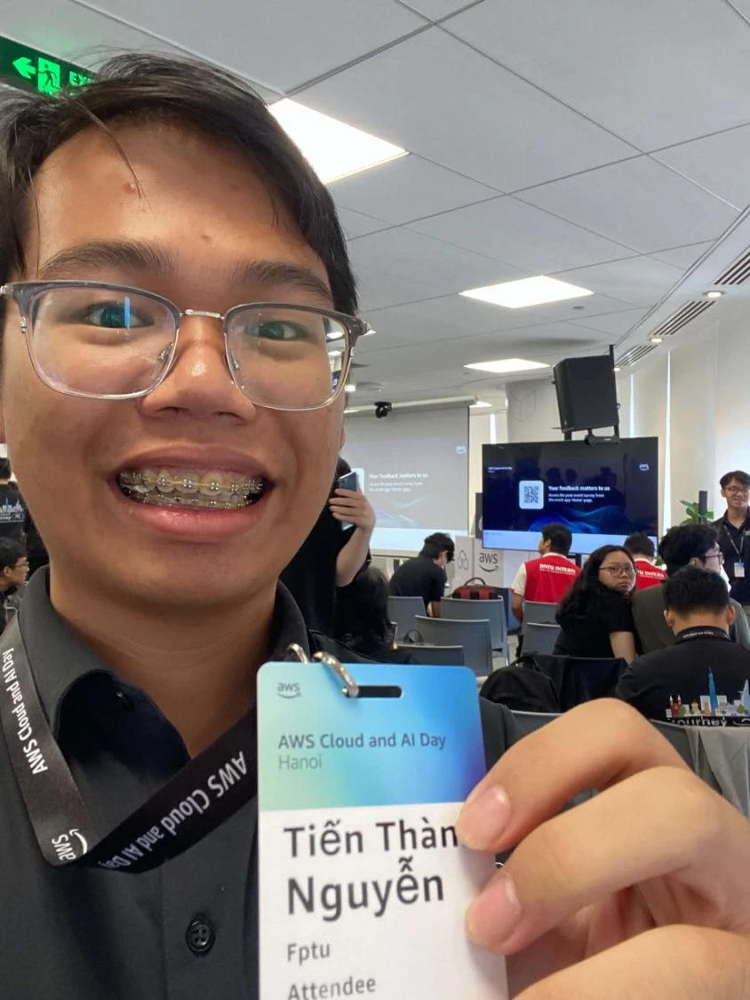

# BÀI THU HOẠCH "AWS CLOUD AND AI DAY HANOI 2026"

### Thông tin sự kiện
- **Thời gian:** 08:00 – 17:00, Thứ Ba 29/09/2026
- **Địa điểm:** Xem trực tiếp (watch party) tại văn phòng AWS TP.HCM, tầng 26 và 36, Bitexco Financial Tower. Sự kiện chính diễn ra tại JW Marriott Hotel Hà Nội.
- **Đơn vị tổ chức:** Amazon Web Services Việt Nam
- **Vai trò của em:** Người tham dự (đăng ký qua trang sự kiện chính thức của AWS, nhận thẻ Attendee)

### Mục đích của sự kiện
- Sự kiện Cloud & AI lớn nhất năm của AWS tại Việt Nam, quy tụ lãnh đạo doanh nghiệp, đối tác, kỹ sư và cộng đồng builder.
- Chia sẻ cách AWS và khách hàng dùng hệ thống agentic để hỗ trợ lập trình viên, hiện đại hoá ứng dụng và bảo mật tổ chức.
- Các phiên chuyên đề về agentic AI, dữ liệu và phân tích, migration, giải pháp theo ngành và phát triển ứng dụng hiện đại.

### Nội dung nổi bật
**Từ "dùng thử" sang "vận hành trưởng thành"**
- Câu hỏi không còn là có dùng cloud/AI hay không, mà là đưa vào vận hành thật thế nào: ai sở hữu hệ thống, ranh giới truy cập, khả năng quan sát (observability), độ bền, quản trị chi phí và kiểm soát bảo mật.

**Agentic AI là chủ đề xuyên suốt**
- Agent hỗ trợ viết code, hiện đại hoá, migration và tự động hoá quy trình doanh nghiệp.
- Khi AI chuyển từ "sinh nội dung" sang "thực hiện hành động" (gọi API, sửa code, kích hoạt deploy), nó trở thành bài toán **danh tính, phân quyền, phê duyệt và kiểm toán**.

**Platform engineering vẫn là nền móng**
- AI giúp làm nhanh hơn, nhưng muốn nhanh mà vẫn an toàn thì cần nền tảng có sẵn rào chắn: mẫu triển khai thống nhất, cấu hình mặc định an toàn, policy, quan sát hệ thống và kiểm soát chuỗi cung ứng phần mềm.

**Danh tính của workload (non-human identity)**
- Pipeline CI/CD, hàm serverless, container và AI agent đều cần danh tính riêng để gọi AWS. Thực hành tốt là dùng credential ngắn hạn, federation, trust policy chặt và kiểm tra liên tục.

**Hạ tầng AWS tại Việt Nam và hệ sinh thái**
- AWS Direct Connect tại Hà Nội và Hanoi Local Zone mở thêm lựa chọn về độ trễ thấp, kết nối riêng và dữ liệu đặt tại chỗ.
- Câu chuyện khách hàng (như TCBS) cho thấy AI thay đổi cả quy trình làm việc của đội kỹ sư, không chỉ thêm một công cụ.
- Số liệu cộng đồng: hơn 157.000 người được đào tạo cloud & AI, hơn 54.000 thành viên AWS Study Group, hơn 15.000 người tham gia hệ sinh thái First Cloud AI Journey.

### Những gì em học được
- **Bảo mật danh tính cho máy quan trọng ngang danh tính cho người.** Điều này thôi thúc em tìm hiểu cách cho GitHub Actions deploy bằng OIDC thay cho access key. Đây về sau là nội dung blog thứ 3 của nhóm.
- **Rào chắn phải đi trước tốc độ.** Pipeline DevSecOps của nhóm (gitleaks, Checkov, Trivy, Bandit, test IaC, CI chặn merge) chính là dạng "platform guardrail" mà các phiên chia sẻ nhắc tới.
- **Chọn kiến trúc phải xét cả vận hành và chi phí**, không chỉ việc có chạy được hay không.

### Ứng dụng vào công việc
- Đưa nguyên tắc "credential ngắn hạn, quyền tối thiểu" vào thiết kế: mỗi Lambda một IAM role riêng; CI hướng tới OIDC.
- Coi bảo mật là một phần của nền tảng chứ không phải bước kiểm tra cuối cùng (shift-left).

### Trải nghiệm trong sự kiện
Đây là lần đầu em theo dõi trọn một ngày sự kiện lớn của AWS. Dù xem qua màn hình tại văn phòng TP.HCM, không khí vẫn rất sôi động. Em có dịp trao đổi với các bạn thực tập sinh khác về cách mỗi nhóm chọn đề tài và kiến trúc.

### Hình ảnh tham gia sự kiện

### Bài học rút ra
Đưa cloud và AI từ demo vào vận hành thật cần ba thứ: danh tính rõ ràng cho cả người lẫn máy, nền tảng có rào chắn an toàn, và số đo cụ thể về hiệu quả và chi phí.
