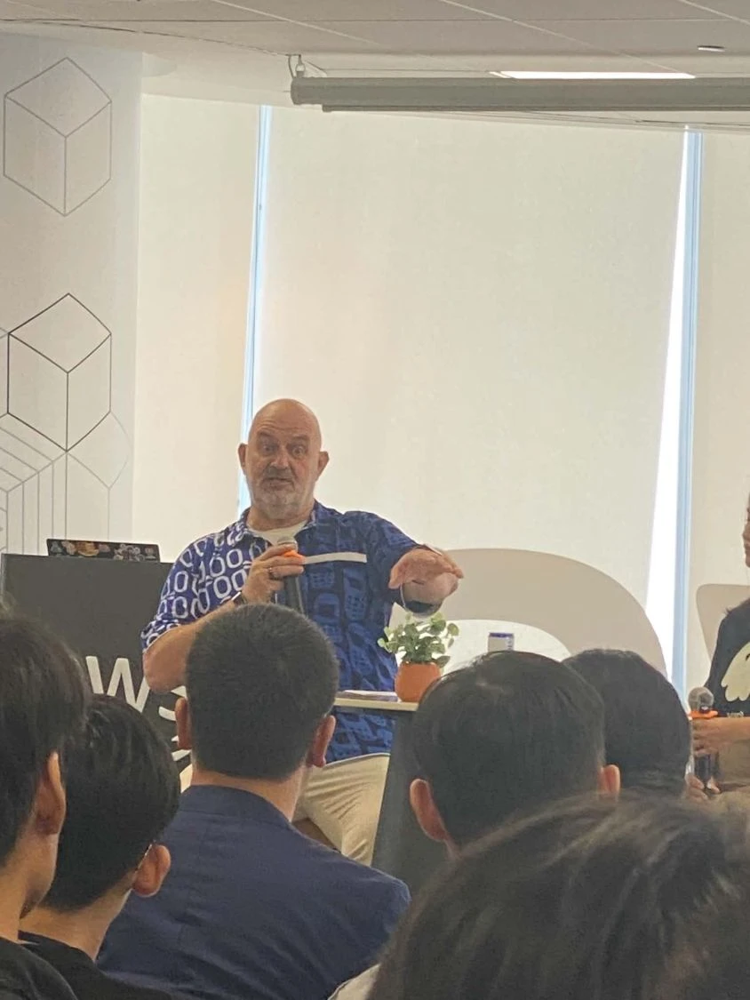

# EVENT REPORT: "FIRESIDE CHAT WITH DR. WERNER VOGELS"

### Event information
- **Date & time:** 08:30 – 12:00, Friday 10/02/2026
- **Location:** AWS office, Bitexco Financial Tower, 2 Hai Trieu, Ho Chi Minh City
- **Speaker:** Dr. Werner Vogels – Chief Technology Officer and Vice President, Amazon
- **Format:** Fireside chat and live Q&A with students, developers and solution architects
- **My role:** Attendee (registered via Luma)

### Purpose of the event
- Hear first-hand from one of the pioneers of cloud computing about the future of Cloud and AI.
- Learn lessons from building and operating systems at global scale.
- Ask questions and connect with the builder community.

### Highlights
**From an outage to DynamoDB**
- In its early years, Amazon suffered a serious database outage during the peak shopping season, causing heavy losses.
- When the team analyzed how data was actually accessed, most queries turned out to be simple key-value lookups (for example, a shopping cart by ID); only a small share truly needed relational features. Amazon then built its own distributed key-value store, the foundation of Dynamo and DynamoDB.

**Operational excellence**
- **Measure at high percentiles (P99.9)**, not averages: averages hide the worst experience of many users.
- **"Everything fails all the time"**: design so that losing one or two data centers does not stop the service.
- **GameDays**: deliberately cut real systems during drills to test automatic failover.
- **Pay-as-you-go**: it inverts the IT economic model; the provider must earn customers' trust every day.

**The "Renaissance Developer" in the AI era**
- Developers will not be replaced if they keep evolving, with 5 traits: **curiosity and continuous learning**, **systems thinking**, **ownership**, **T-shaped expertise** and **communication skills**.
- AI is like an imprecise "natural-language compiler": it shortens prototyping, but its output must still be reviewed by humans for security, edge cases and efficiency. Ultimate responsibility for production code stays with the engineer.
- A warning against "we've always done it this way": old habits are the biggest risk in technology.

### What I learned
- **Design data around how it is accessed.** This is exactly how our team designed DynamoDB for SecureTable: list the access patterns first, then add the `status_created_at_idx` GSI for the kitchen screen instead of scanning the table.
- **Failure drills are mandatory.** The GameDay idea is the basis for the "nuke then redeploy" drill I planned for the project: a system is only trustworthy once it has actually been rebuilt from scratch.
- **Measure the right metric.** Load tests should report p95/p99, not just average latency.
- **Ownership of AI-assisted code.** I use AI to learn and draft, so I must understand and check every line myself before it goes into the team repo.

### Applying it to my work
- Added a recovery drill (nuke → redeploy, timed) to the final-phase plan.
- Report latency by percentile (p95/p99) in the load test.
- Every infrastructure change goes through a pull request, CI and tests, including AI-assisted drafts.

### Event experience
Hearing Amazon's CTO explain the decisions behind services I use every day (DynamoDB, S3) was a very special experience. The Q&A felt close and personal: students' worries about whether AI will replace developers got honest, practical answers.

### Event photos

### Key takeaway
Technology changes fast, but some principles do not: understand the real problem, design for failure, measure seriously and own what you build. AI is a catalyst; judgment and responsibility remain human.

*Further reading: [The Invariable Lessons of Tech and Humanity – AWS Builder Center](https://builder.aws.com/content/3KBSLeKsdkk6uMUPq7d9Xxa5jbS/the-invariable-lessons-of-tech-and-humanity-key-takeaways-from-amazon-cto-werner-vogels)*
