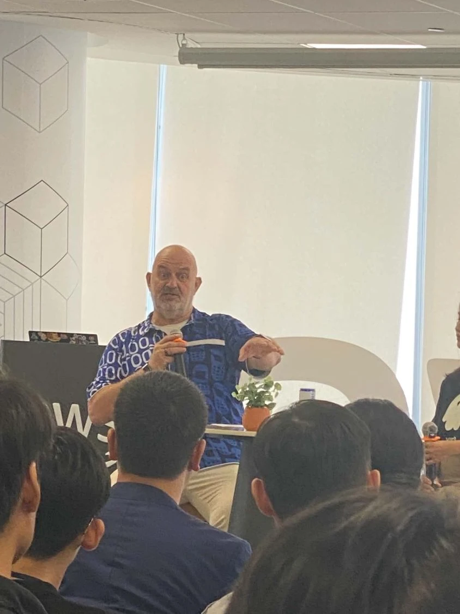

# BÀI THU HOẠCH "FIRESIDE CHAT WITH DR. WERNER VOGELS"

### Thông tin sự kiện
- **Thời gian:** 08:30 – 12:00, Thứ Sáu 02/10/2026
- **Địa điểm:** Văn phòng AWS, Bitexco Financial Tower, 2 Hải Triều, TP.HCM
- **Diễn giả:** Dr. Werner Vogels – Giám đốc Công nghệ (CTO) kiêm Phó Chủ tịch Amazon
- **Hình thức:** Trò chuyện (fireside chat) và hỏi đáp trực tiếp với cộng đồng sinh viên, lập trình viên, kiến trúc sư giải pháp
- **Vai trò của em:** Người tham dự (đăng ký qua Luma)

### Mục đích của sự kiện
- Nghe chia sẻ trực tiếp từ một trong những người tiên phong của điện toán đám mây về tương lai của Cloud và AI.
- Học bài học xây dựng và vận hành hệ thống ở quy mô toàn cầu.
- Giao lưu, đặt câu hỏi với diễn giả và kết nối với cộng đồng builder.

### Nội dung nổi bật
**Từ một sự cố tới DynamoDB**
- Thời kỳ đầu, Amazon từng gặp một sự cố cơ sở dữ liệu nghiêm trọng đúng vào mùa mua sắm cao điểm, gây thiệt hại lớn.
- Khi phân tích lại cách dữ liệu thực sự được truy cập, đội kỹ sư thấy phần lớn truy vấn chỉ là dạng key-value đơn giản (ví dụ lấy giỏ hàng theo ID); chỉ một phần nhỏ thật sự cần tính năng quan hệ. Từ đó Amazon tự xây kho key-value phân tán, nền móng của Dynamo và DynamoDB.

**Vận hành xuất sắc**
- **Đo ở phân vị cao (P99.9)** thay vì trung bình: trung bình che mất trải nghiệm tệ nhất của nhiều người dùng.
- **"Everything fails all the time"**: thiết kế để mất một, hai trung tâm dữ liệu mà dịch vụ vẫn chạy.
- **GameDay**: chủ động ngắt hệ thống thật trong buổi diễn tập để kiểm tra khả năng tự chuyển đổi dự phòng.
- **Trả tiền theo mức dùng**: đảo ngược mô hình kinh tế IT, nhà cung cấp phải làm tốt mỗi ngày để giữ khách hàng.

**"Renaissance Developer" trong thời đại AI**
- Lập trình viên không bị thay thế nếu tiếp tục phát triển, với 5 phẩm chất: **tò mò và học liên tục**, **tư duy hệ thống**, **tinh thần làm chủ (ownership)**, **kiến thức hình chữ T** và **kỹ năng giao tiếp**.
- AI giống một "trình biên dịch ngôn ngữ tự nhiên" chưa chính xác: rút ngắn thời gian làm prototype, nhưng đầu ra vẫn phải được con người kiểm tra về bảo mật, trường hợp biên và hiệu năng. Trách nhiệm cuối cùng với code chạy production vẫn thuộc về kỹ sư.
- Cảnh báo về tư duy "trước giờ vẫn làm vậy": thói quen cũ là rủi ro lớn nhất trong ngành công nghệ.

### Những gì em học được
- **Thiết kế dữ liệu theo cách dữ liệu được truy cập.** Đây đúng là cách nhóm thiết kế DynamoDB cho SecureTable: liệt kê access pattern trước, thêm GSI `status_created_at_idx` cho màn hình bếp thay vì quét cả bảng.
- **Diễn tập sự cố là bắt buộc.** Ý tưởng GameDay là cơ sở cho buổi diễn tập "nuke rồi deploy lại" mà em lên kế hoạch cho dự án: hệ thống chỉ đáng tin khi đã thật sự dựng lại được từ đầu.
- **Đo đúng chỉ số.** Khi kiểm thử tải cần nhìn p95/p99 chứ không chỉ độ trễ trung bình.
- **Ownership với code do AI hỗ trợ.** Em dùng AI để học và viết nháp, nên càng phải tự hiểu và tự kiểm tra từng dòng trước khi đưa vào repo nhóm.

### Ứng dụng vào công việc
- Thêm bước diễn tập khôi phục (nuke → deploy lại, đo thời gian) vào kế hoạch giai đoạn cuối.
- Trong bài kiểm thử tải, báo cáo độ trễ theo phân vị (p95/p99).
- Mọi thay đổi hạ tầng đều qua pull request và CI, có test, kể cả khi bản nháp do AI hỗ trợ.

### Trải nghiệm trong sự kiện
Được nghe trực tiếp CTO của Amazon kể lại các quyết định đã tạo nên những dịch vụ em đang dùng mỗi ngày (DynamoDB, S3) là trải nghiệm rất đặc biệt. Phần hỏi đáp gần gũi: những câu hỏi lo lắng của sinh viên về việc "AI có thay thế lập trình viên không" được trả lời thẳng thắn và thực tế.

### Hình ảnh tham gia sự kiện

### Bài học rút ra
Công nghệ thay đổi rất nhanh, nhưng những nguyên tắc như hiểu đúng bài toán, thiết kế để chịu lỗi, đo lường nghiêm túc và chịu trách nhiệm với sản phẩm của mình thì không đổi. AI là chất xúc tác, còn tư duy và trách nhiệm vẫn là phần của con người.

*Tham khảo thêm: [The Invariable Lessons of Tech and Humanity – AWS Builder Center](https://builder.aws.com/content/3KBSLeKsdkk6uMUPq7d9Xxa5jbS/the-invariable-lessons-of-tech-and-humanity-key-takeaways-from-amazon-cto-werner-vogels)*
