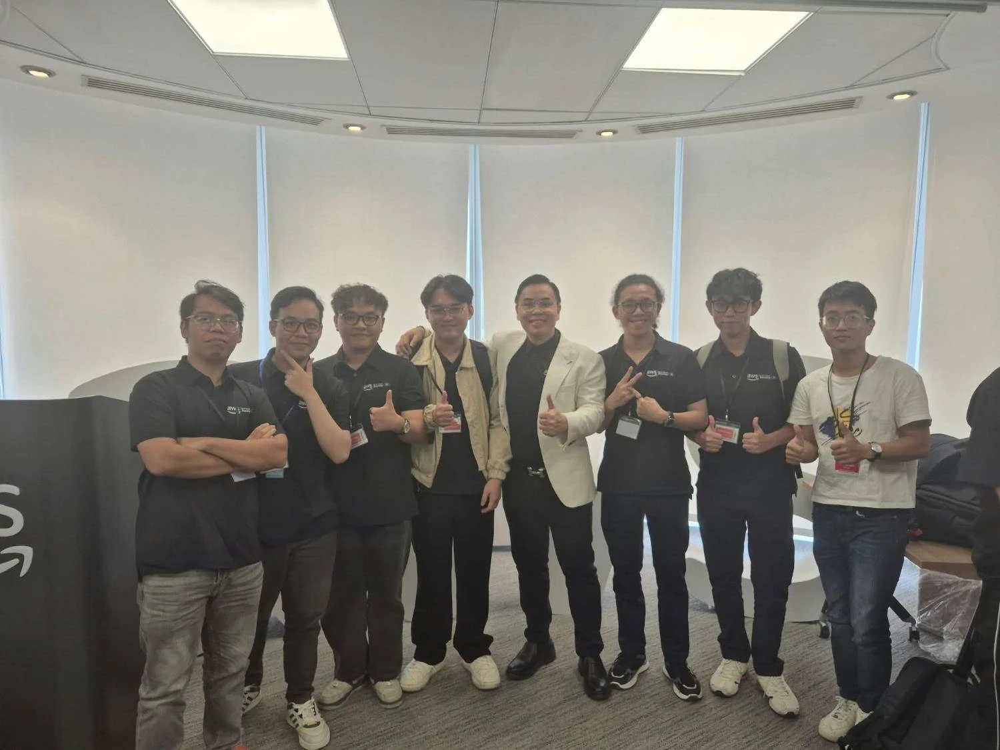

# EVENT REPORT: "FCAJ MEETUP"

<!-- TO FILL IN: the official meetup name, session titles and speakers (check the portal/meetup announcement). The group chat did not include the agenda, so the sections below are a frame. -->

### Event information
- **Date & time:** Morning (half day), Saturday 11/21/2026
- **Location:** AWS office, 26th floor, Bitexco Financial Tower, 2 Hai Trieu, Ho Chi Minh City
- **Organizer:** First Cloud AI Journey (FCAJ)
- **My role:** Attendee (registered on the portal and the meetup page)

### Purpose of the event
- A community gathering where FCAJ interns and practitioners share knowledge and real-world AWS experience.
- A chance for intern teams to connect in the final phase, while finishing their architectures and preparing Workshop submissions.

### Highlights
- **[Session 1 – add title and speaker]:** [2–3 key points]
- **[Session 2 – add title and speaker]:** [2–3 key points]
- **Networking and Q&A:** discussions with other teams on presenting architectures, numbering data flows and estimating project costs.

### What I learned
- **Present architecture as a business flow.** In week 10 the mentors told teams not to just list services, but to number the paths and describe each step. I applied this to update the SecureTable v2 diagram with 14 annotated steps.
- **Seeing how other teams handle cost and security** (NAT Gateway, WAF, queues to absorb load) helped me re-check our own decisions.
- **Learning from the community.** Other people's real questions often reveal what I had not considered.

### Applying it to my work
- Finished architecture diagram v2 and the End-to-End Workflow description for the team summary file.
- Prepared explanations for each design decision (why serverless, why WAF on demand, why no GuardDuty or CMK) for the final defense.

### Event experience
The meetup came near the end of the internship, so the mood was both fun and "final sprint". Everyone shared the difficulties of finishing their projects, and our group took a souvenir photo with other FCAJ interns.

### Event photos

### Key takeaway
A good architecture must be understandable to others: number the flows, explain the reasons and show the cost figures. The community is the fastest place to test that.
