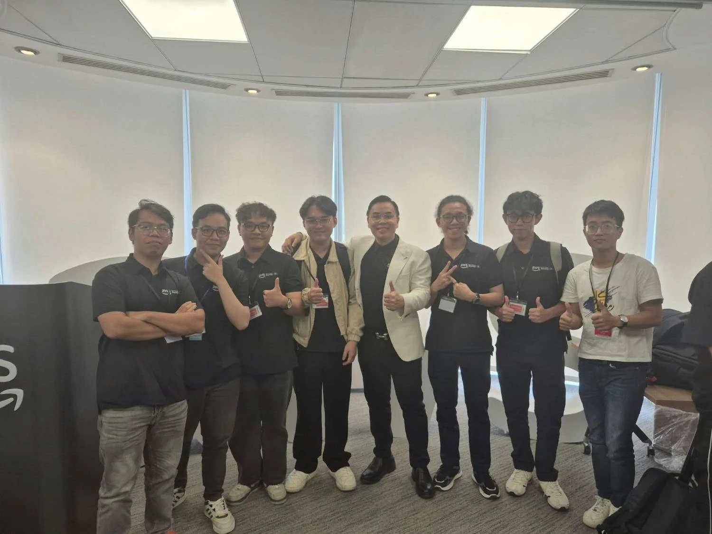

# BÀI THU HOẠCH "FCAJ MEETUP"

<!-- CẦN BỔ SUNG: tên chính thức của buổi meetup, tên các phiên chia sẻ và diễn giả (xem lại thông báo trên portal/meetup). Nhóm chat không ghi chương trình nên phần dưới chỉ để khung. -->

### Thông tin sự kiện
- **Thời gian:** Buổi sáng (nửa ngày), Thứ Bảy 21/11/2026
- **Địa điểm:** Văn phòng AWS, tầng 26, Bitexco Financial Tower, 2 Hải Triều, TP.HCM
- **Đơn vị tổ chức:** First Cloud AI Journey (FCAJ)
- **Vai trò của em:** Người tham dự (đăng ký trên portal và trang meetup)

### Mục đích của sự kiện
- Buổi gặp mặt cộng đồng FCAJ để các thực tập sinh và người đi làm chia sẻ kiến thức, kinh nghiệm triển khai thực tế trên AWS.
- Tạo cơ hội kết nối giữa các nhóm thực tập ở giai đoạn cuối, khi các nhóm đang hoàn thiện kiến trúc và chuẩn bị nộp Workshop.

### Nội dung nổi bật
- **[Phiên 1 – bổ sung tên phiên và diễn giả]:** [tóm tắt 2–3 ý chính]
- **[Phiên 2 – bổ sung tên phiên và diễn giả]:** [tóm tắt 2–3 ý chính]
- **Giao lưu và hỏi đáp:** trao đổi với các nhóm khác về cách trình bày kiến trúc, đánh số luồng xử lý và tính chi phí cho dự án.

### Những gì em học được
- **Trình bày kiến trúc theo luồng nghiệp vụ.** Mentor góp ý cho các nhóm trong tuần 10 rằng không nên chỉ liệt kê dịch vụ, mà phải đánh số đường đi và mô tả từng bước. Em áp dụng góp ý này để cập nhật sơ đồ SecureTable v2 với 14 bước có chú thích.
- **Nghe cách nhóm khác giải bài toán chi phí và bảo mật** (NAT Gateway, WAF, hàng đợi để giảm tải) giúp em tự rà lại các quyết định của nhóm mình.
- **Học từ cộng đồng.** Câu hỏi thực tế của người khác thường chỉ ra những điểm mình chưa nghĩ tới.

### Ứng dụng vào công việc
- Hoàn thiện sơ đồ kiến trúc v2 và bản mô tả End-to-End Workflow cho file summary của nhóm.
- Chuẩn bị phần giải thích từng quyết định thiết kế (vì sao serverless, vì sao WAF bật theo nhu cầu, vì sao bỏ GuardDuty và CMK) cho buổi bảo vệ.

### Trải nghiệm trong sự kiện
Buổi meetup diễn ra vào giai đoạn cuối kỳ thực tập nên không khí vừa vui vừa "nước rút". Mọi người cùng chia sẻ khó khăn khi hoàn thiện dự án, và nhóm em chụp ảnh lưu niệm cùng các bạn thực tập sinh FCAJ.

### Hình ảnh tham gia sự kiện

### Bài học rút ra
Một kiến trúc tốt phải được người khác hiểu được: đánh số luồng, giải thích lý do và đưa ra số liệu chi phí. Cộng đồng là nơi kiểm chứng điều đó nhanh nhất.
