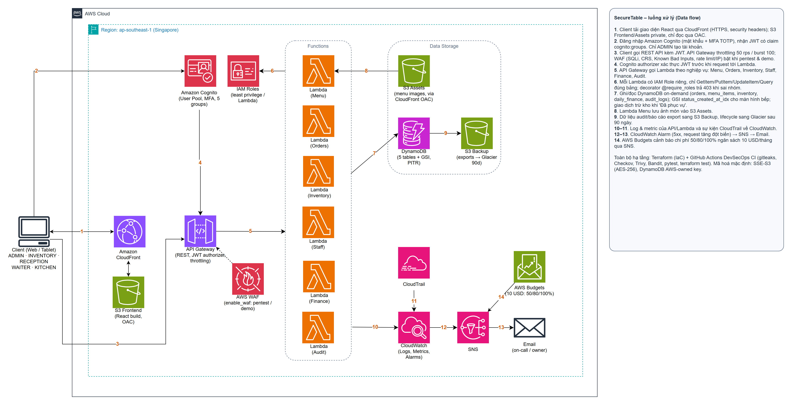

### The problem
Small eateries take orders verbally or on paper, don't know their stock, calculate bills with a pocket calculator and have no trace of who edited a bill. SecureTable digitizes the **order → kitchen → stock deduction → payment** flow for 5 roles (ADMIN, INVENTORY, RECEPTION, WAITER, KITCHEN), with multi-layer security and a cost under 10 USD/month.

### Architecture

| Step | Flow |
| --- | --- |
| 1 | The client loads the React UI through CloudFront; S3 `frontend`/`assets` are private and only readable via OAC |
| 2 | Sign in to Cognito (password + TOTP MFA) and receive a JWT with the `cognito:groups` claim |
| 3 | The client calls the REST API with the JWT; API Gateway throttles at 50 rps/burst 100; WAF filters SQLi/XSS when enabled |
| 4 | The Cognito authorizer validates the JWT |
| 5–6 | API Gateway invokes Lambda; each Lambda has its own IAM role; the `@require_roles` decorator returns 403 for the wrong role |
| 7 | Lambda reads/writes DynamoDB (5 tables + GSI); "served" uses a transaction to deduct stock |
| 8–9 | Menu images live in S3 `assets`; audit/report exports go to S3 `backup` (Glacier after 90 days) |
| 10–13 | Logs/metrics go to CloudWatch; CloudTrail records management API calls; alarm → SNS → email |
| 14 | AWS Budgets alerts at 50/80/100% of the 10 USD budget |

### Why these services
- **Serverless (Lambda, API Gateway, DynamoDB on-demand)**: no servers running 24/7. The trial 3-tier EC2 + RDS + NAT Gateway version was estimated at 20–50 USD/month.
- **Cognito**: built-in OAuth 2.0/JWT, MFA and user groups, free under 10,000 MAU.
- **CloudFront + S3 OAC**: HTTPS, edge caching, no public bucket needed.
- **WAF on demand**: 5 USD per Web ACL + 1 USD per rule per month, enabled only for pentest/demo.
