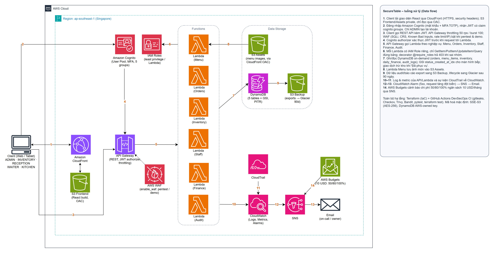

### Bài toán
Quán ăn nhỏ gọi món bằng lời nói và sổ tay, không biết tồn kho, tính tiền bằng máy tính bỏ túi và không có dấu vết ai sửa hoá đơn. SecureTable số hoá luồng **gọi món → bếp → trừ kho → thanh toán** cho 5 vai trò (ADMIN, INVENTORY, RECEPTION, WAITER, KITCHEN), với bảo mật nhiều lớp và chi phí dưới 10 USD/tháng.

### Kiến trúc

| Bước | Luồng xử lý |
| --- | --- |
| 1 | Client tải giao diện React qua CloudFront; S3 `frontend`/`assets` private, chỉ đọc qua OAC |
| 2 | Đăng nhập Cognito (mật khẩu + MFA TOTP), nhận JWT có claim `cognito:groups` |
| 3 | Client gọi REST API kèm JWT; API Gateway throttling 50 rps/burst 100; WAF lọc SQLi/XSS khi bật |
| 4 | Cognito authorizer xác thực JWT |
| 5–6 | API Gateway gọi Lambda; mỗi Lambda có IAM role riêng; decorator `@require_roles` trả 403 khi sai vai trò |
| 7 | Lambda đọc/ghi DynamoDB (5 bảng + GSI); "Đã phục vụ" dùng giao dịch để trừ kho |
| 8–9 | Ảnh món lưu ở S3 `assets`; dữ liệu audit/báo cáo xuất sang S3 `backup` (Glacier sau 90 ngày) |
| 10–13 | Log/metric về CloudWatch; CloudTrail ghi API quản trị; alarm → SNS → email |
| 14 | AWS Budgets cảnh báo 50/80/100% ngân sách 10 USD |

### Vì sao chọn các dịch vụ này
- **Serverless (Lambda, API Gateway, DynamoDB on-demand)**: không có máy chủ chạy 24/7; bản 3-tier EC2 + RDS + NAT Gateway nhóm dựng thử tốn ước tính 20–50 USD/tháng.
- **Cognito**: OAuth 2.0/JWT, MFA, nhóm người dùng có sẵn, miễn phí với dưới 10.000 MAU.
- **CloudFront + S3 OAC**: HTTPS, cache tại edge, bucket không cần public.
- **WAF bật theo nhu cầu**: 5 USD/Web ACL + 1 USD/rule mỗi tháng, chỉ bật khi pentest/demo.
